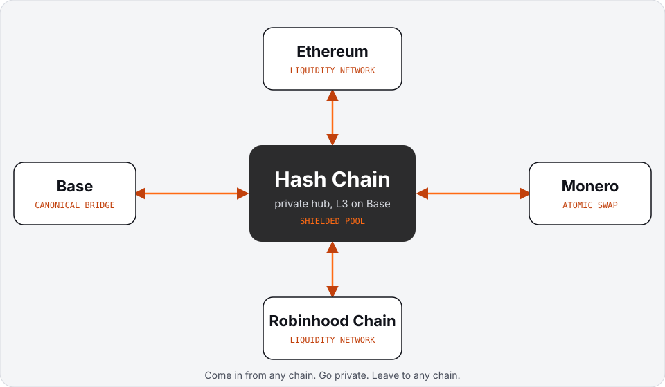

# Hash Chain Protocol Spec

Specification for Hash Chain, the privacy Layer 0: its own network with its own validators, where accounts, payments, swaps, assets and apps are private by default, connected to Ethereum, Base, Robinhood Chain and Monero.

> **STATUS: pre-launch, spec stage.** Every document here is a draft and may change without notice. Nothing described is deployed or audited. Parameters, mechanisms and names are proposals until marked otherwise. Where a point is undecided, the document says so under "Open questions".

## What this repository is

The written design of Hash Chain: what the system is for, how its parts fit, which assumptions it makes, and what is still undecided. It is meant to be read by users who want to know what they would be trusting, by integrators, and by reviewers who want to find mistakes early.

Each document starts with a plain "In short" block, then explains the topic, then gives "Technical details", then lists "Open questions".

## Table of contents

| Doc | Topic |
| --- | --- |
| [00 Overview](docs/00-overview.md) | The problem, the idea, and the whole system on one page |
| [01 Architecture](docs/01-architecture.md) | Validator network, consensus, account chains, shielded state, connections |
| [02 Validators and staking](docs/02-validators-and-staking.md) | ETH stake, roles, slashing conditions |
| [03 Accounts and private transfers](docs/03-accounts-and-private-transfers.md) | Notes, commitments, nullifiers, proofs, stealth addresses, account chains |
| [04 Private payments](docs/04-private-payments.md) | Transfers, payment links, batch payouts, checkout |
| [05 Private swaps](docs/05-private-swaps.md) | Hidden order flow and front-running resistance |
| [06 Private assets](docs/06-private-assets.md) | Issuance and transfer rules enforced by proofs |
| [07 Private apps](docs/07-private-apps.md) | Private contract model and SDK preview |
| [08 Proofs and view keys](docs/08-proofs-and-view-keys.md) | View keys, credentials and selective disclosure |
| [09 Security and trust](docs/09-security-and-trust.md) | Trust assumptions and risks, stated plainly |
| [10 Connections](docs/10-connections.md) | Ethereum, Base and Robinhood Chain, plus the liquidity network |
| [11 Monero connection](docs/11-connection-monero.md) | Trustless XMR and ETH atomic swaps |
| [12 Fees](docs/12-fees.md) | What you pay for, in ETH |
| [13 Roadmap](docs/13-roadmap.md) | Phases, without dates |
| [Glossary](docs/glossary.md) | Terms used in the spec |
| [FAQ](docs/faq.md) | Common questions |

Suggested reading order: Overview, Architecture, then the pillar you care about, then Security and trust.

See the [changelog](CHANGELOG.md) for release history.

## Diagrams

- [diagrams/hub.svg](diagrams/hub.svg): the privacy Layer 0 in layers: validators, private by default, pillars and connections
- [diagrams/network-topology.svg](diagrams/network-topology.svg): validators, account chains, proof verification and connections
- [diagrams/xmr-swap-sequence.svg](diagrams/xmr-swap-sequence.svg): Monero swap, happy path

## Contributing

Issues and pull requests are welcome. See [CONTRIBUTING.md](CONTRIBUTING.md). Security reports go through [SECURITY.md](SECURITY.md). Participation is governed by the [Code of Conduct](CODE_OF_CONDUCT.md).

## Links

- Website: https://hashchain.network
- X: https://x.com/hashchainL0
- GitHub: https://github.com/HashChainL0
- Brand kit: https://github.com/HashChainL0/brand-kit

## License

Documentation in this repository is licensed under [Creative Commons Attribution 4.0 International (CC BY 4.0)](https://creativecommons.org/licenses/by/4.0/). See [LICENSE](LICENSE). The Hash Chain name and logo are covered separately in the brand kit.
