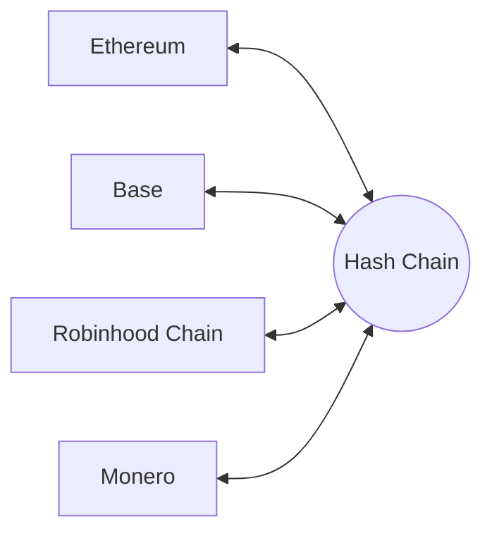

# 00 Overview

> Draft. Pre-launch, spec stage. Everything here may change.

## In short

Hash Chain is a privacy chain that acts as a private hub between Ethereum, Base, Robinhood Chain and Monero. You come in from one network, move or hold funds privately, and leave to another network, and outside observers cannot connect the entry to the exit. Gas is paid in ETH.

## The problem

On Ethereum, Base and Robinhood Chain, every balance and every transfer is public. Your employer, a stranger or a competitor can see what you hold, who paid you and what you paid. For many people and businesses that is a real obstacle to using these networks at all.

Monero went the other way. It is private by default, but it is disconnected from the Ethereum world. Moving value between Monero and an Ethereum-style network normally means handing funds to an exchange or another custodian.

Existing approaches tend to cover one chain at a time. Hash Chain aims at one private place that every supported network can reach.

## The idea

Hash Chain is a hub with a private core.

1. **Come in** from any supported chain.
2. **Go private.** Funds become shielded notes inside Hash Chain. Transfers inside the chain hide amounts and parties.
3. **Leave anywhere.** Withdraw to any supported chain. An outside observer who watches the origin and the destination cannot link them.

## What Hash Chain is, technically

- An **L3** that settles on Base and is secured by Ethereum through Base.
- A **shielded pool** that holds value as notes in a Merkle tree, with nullifiers preventing double spends and zero-knowledge proofs showing that each transfer is valid.
- **Stealth addresses** so receivers do not reuse a visible address.
- **Three kinds of route** into and out of the pool: a canonical bridge with Base, a liquidity network with Ethereum and Robinhood Chain, and atomic swaps with Monero.
- **View keys** for users who choose to disclose their own history to an accountant or auditor.

## What Hash Chain is not

- Not a promise of anonymity under all conditions. Privacy depends on the size of the anonymity set and on user behavior. See [Security and trust](09-security-and-trust.md).
- Not a custodian. No route is designed to require handing funds to a trusted third party.
- Not live. This is a draft specification.

## Who it is for

People and organizations who want ordinary financial privacy: paying suppliers without exposing a treasury, receiving salary without publishing it, holding savings without advertising them. View keys exist so that privacy can coexist with tax and audit obligations. The positioning is private, not shady.

## Technical details

Terminology used throughout:

| Term | Meaning |
| --- | --- |
| Origin | The chain where a route begins |
| Destination | The chain where a route ends |
| Route | A defined way to move value between a chain and the pool |
| Pool | The shielded pool on Hash Chain |
| Note | A private unit of value inside the pool |

The remaining documents define each part: [architecture](01-architecture.md), [routes](02-routes.md), the three route families, [shielded transfers](06-shielded-transfers.md), [view keys](07-view-keys.md), [fees](08-fees.md), [security](09-security-and-trust.md) and the [roadmap](10-roadmap.md).

## Open questions

- Which assets beyond ETH are supported on each route, and in what order.
- The exact proving system and setup, listed in [06](06-shielded-transfers.md) and [09](09-security-and-trust.md).
- Governance and upgrade authority for the contracts, including how emergency actions are limited.
