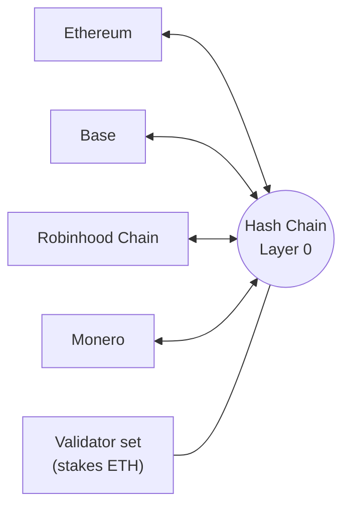

# 00 Overview

> Draft. Pre-launch, spec stage. Everything here is a design and may change. Nothing is deployed or audited.

## In short

Hash Chain is the privacy Layer 0: its own network, run by its own validators, where accounts, payments, swaps, assets and apps are private by default. It connects to Ethereum, Base, Robinhood Chain and Monero. You go in public, and you come out private.

## The problem

- Public chains publish everything. Every balance, salary, trade and counterparty is visible forever.
- That blocks real finance. Businesses cannot pay suppliers in public, traders get front-run and copied, and people get tracked.
- Privacy today is bolted on: mixers, isolated privacy coins and separate apps. Monero is private but cut off from the Ethereum world.

## The idea

Make privacy a property of the base layer instead of an add-on. Hash Chain is a network of its own, and other chains plug into it. Every account is a shielded account by default. The position is the same as a payments-focused base layer for finance, with privacy as the default.

## The whole system on one page

1. **Private accounts.** Balances and history are hidden by default. One account holds any connected asset.
2. **Private payments.** Private transfers of ETH and stablecoins, payment links, batch payouts and merchant checkout. See [04](04-private-payments.md).
3. **Private swaps.** A native exchange layer where trades, sizes and wallets are not visible. See [05](05-private-swaps.md).
4. **Private assets.** Issue and hold tokenized assets with private balances. See [06](06-private-assets.md).
5. **Private apps.** Contracts whose inputs and state stay hidden. See [07](07-private-apps.md).
6. **Proofs, not exposure.** View keys and credentials for audits and taxes. See [08](08-proofs-and-view-keys.md).
7. **Connected to everything.** See [10](10-connections.md) and [11](11-connection-monero.md).

Hash Chain is not a bridge. It is a network of its own. The connections to other networks are doors into and out of it.

## Who it is for

- **People:** stop being tracked; pay and hold privately.
- **Traders:** trade without being front-run or copied.
- **Businesses and fintechs:** pay suppliers and staff, run treasury and accept payments without publishing finances, while staying provable to auditors.
- **Builders:** build private apps without inventing cryptography.
- **Monero holders:** reach the Ethereum world without an exchange.

## What this spec does not claim

No performance figures, no fee amounts, no dates. Technical claims are designs until built and audited. Fees are paid in ETH. No token is required to use the network.

## Technical details

- Network design: [01](01-architecture.md).
- Validators and staking: [02](02-validators-and-staking.md).
- Privacy primitives: [03](03-accounts-and-private-transfers.md).
- Trust assumptions: [09](09-security-and-trust.md).

## Open questions

- Which parts of the system are in the first public test network and which wait for later phases, see [13](13-roadmap.md).
- How the private modules (payments, swaps, assets, apps) share one proof system.
