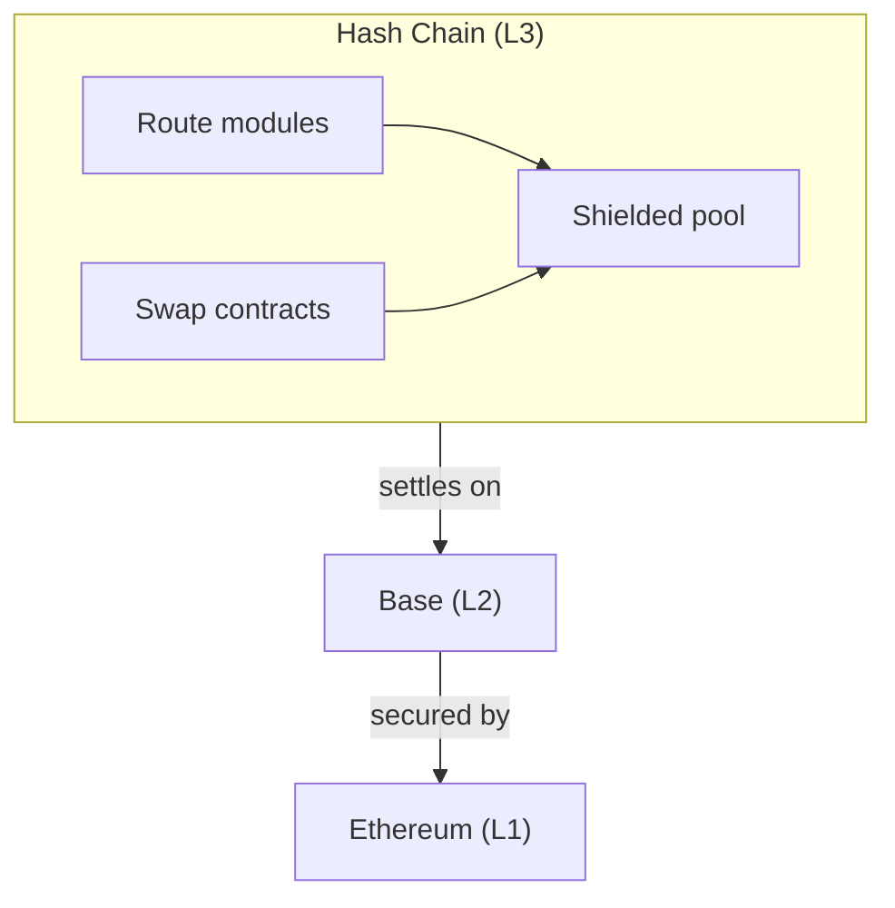
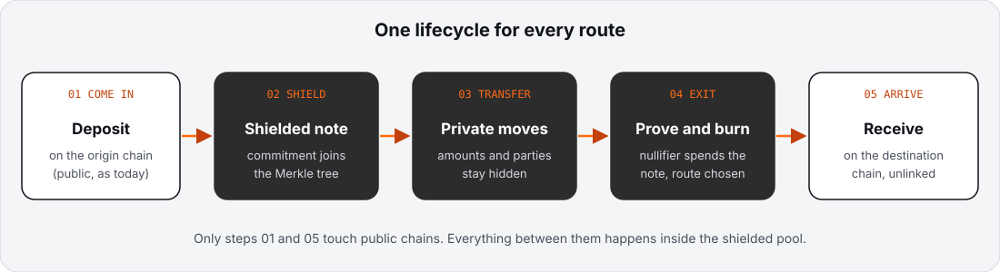
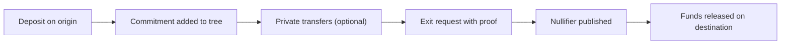

# 01 Architecture

> Draft. Pre-launch, spec stage. Everything here may change.

## In short

Hash Chain is built in layers. Ethereum is the base of security, Base sits on top of Ethereum, and Hash Chain sits on top of Base as an L3. Inside Hash Chain, a shielded pool holds private value, and route modules connect it to the outside world.

## Layers

- **Ethereum** provides the ultimate security anchor.
- **Base** is the settlement layer for Hash Chain. State commitments and data are posted to Base.
- **Hash Chain** runs execution. Gas is paid in ETH.

## Components

**Sequencer.** Orders transactions on Hash Chain and produces blocks. Its trust role is liveness and censorship resistance, not custody. Forced inclusion through Base is a design goal so users can still get a transaction included if the sequencer refuses.

**Shielded pool.** The core contract set. It stores note commitments in a Merkle tree, tracks spent nullifiers and verifies zero-knowledge proofs. See [06](06-shielded-transfers.md).

**Prover and verifier.** Users produce proofs of valid transfers on their own device or through a proving service they choose. The pool contract verifies them on-chain.

**Route modules.** Contracts and off-chain actors that move value in and out of the pool: the canonical bridge ([03](03-route-base.md)), the liquidity network ([04](04-route-ethereum-robinhood.md)) and the Monero swap contract ([05](05-route-monero.md)).

**Relayers (solvers).** Independent actors that front funds on a destination chain for fast routes and are repaid via the canonical path.

**Wallet.** Holds the user's spending keys, scans for incoming notes and builds proofs. View keys are derived here ([07](07-view-keys.md)).

## Lifecycle of a private move

## Technical details

- **Data availability.** Transaction data posted to Base lets anyone reconstruct state. Whether encrypted note payloads are posted to Base, kept by Hash Chain nodes, or both is to be specified.
- **Settlement.** Withdrawals through the canonical bridge follow a challenge window of about seven days. The mechanism that is challenged (fault proofs, validity proofs or a mix) is to be specified.
- **Gas token.** ETH, bridged from Base.
- **Contract upgrades.** Proposed to be constrained by a delay long enough for users to exit. Details to be specified.

## Open questions

- Sequencer decentralization path, and whether to run more than one sequencer.
- Where encrypted note data lives, and the cost trade-off.
- Whether proving is local only or can be delegated, and what delegation leaks.
- Exact design of forced inclusion through Base.
