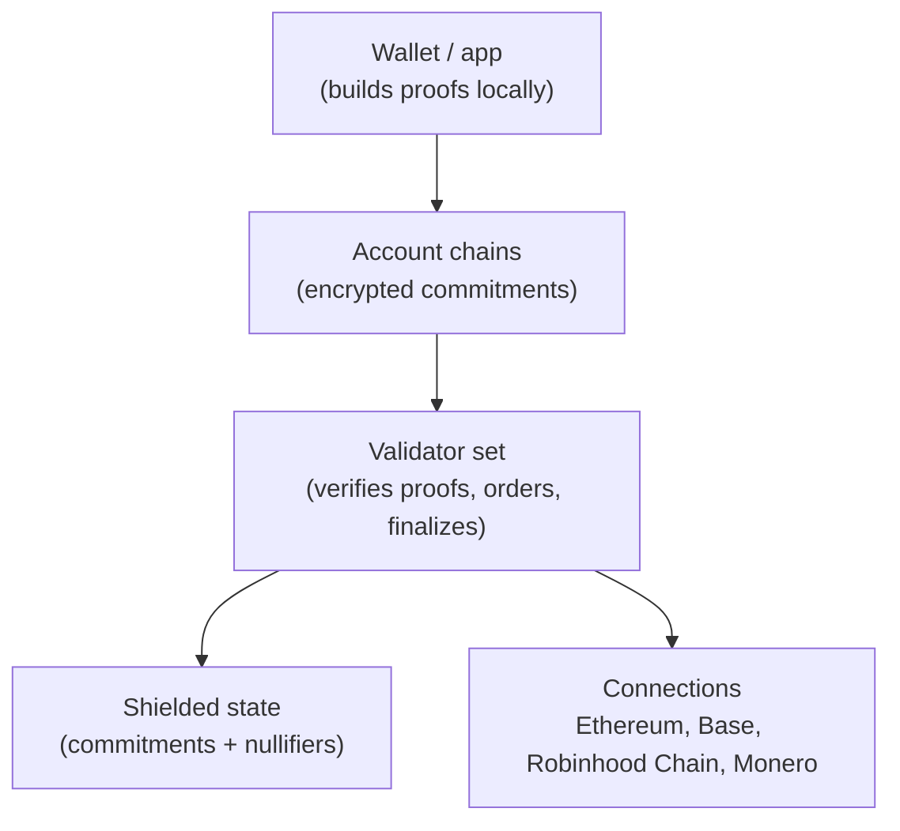
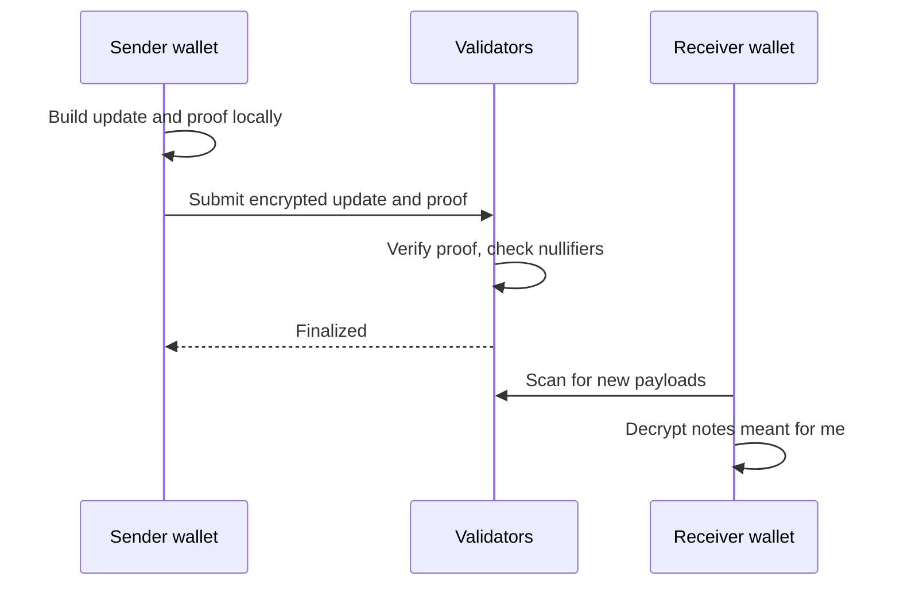

# 01 Architecture

> Draft. Pre-launch, spec stage. All of this is a design target, not a description of running software.

## In short

Hash Chain is a network of validators. Each account keeps its own chain of state updates, so unrelated payments settle in parallel. Account contents are encrypted commitments. Validators check zero-knowledge proofs that every update is valid, and never see amounts or parties. Other networks connect through doors verified by the same validator set.

## Components

### Own validator network

An independent validator set runs the network. Validators stake ETH. Details in [02](02-validators-and-staking.md).

### Consensus

A Byzantine fault tolerant protocol, with fast deterministic finality as a design target. Deterministic means a finalized update is final, not probabilistic. The protocol itself is to be specified. The aim is to settle in moments and support payment-scale throughput. No figures are promised.

### Account chains

Each account has its own sequence of state updates, linked in order. Updates from unrelated accounts do not wait for each other, so they can settle in parallel. Only updates that touch shared state, such as a swap between two accounts, need ordering between chains. The content of every update is an encrypted commitment, validated with a zero-knowledge proof.

### Shielded state

Value is held as private notes. The network stores commitments and spent nullifiers, never the notes themselves. See [03](03-accounts-and-private-transfers.md).

### Proof verification by validators

A user's wallet produces the proof. Validators verify it. A valid proof means: the sender owns the inputs, the totals balance, nothing is spent twice. Validators learn nothing about amounts or parties beyond what the proof makes public.

### Data availability

Where encrypted note payloads and account updates are stored, and who must keep them available, is to be specified. See open questions.

### Connections

Ethereum, Base and Robinhood Chain connect through connection contracts that the validator set verifies, plus a liquidity network for fast transfers. Monero connects through native atomic swaps. See [10](10-connections.md) and [11](11-connection-monero.md).

## How a private payment moves

## Technical details

- **Finality.** An update is final when a supermajority of staked validators signs it. The threshold and weighting are to be specified.
- **Ordering.** Per-account order is a hash-linked sequence. Cross-account order is set by validators. The exact data structure is to be specified.
- **State growth.** Commitments append to a tree and nullifiers to a set. Pruning and archival roles are to be specified.
- **Client work.** Proof generation happens on the user's device. Proof size and cost depend on the proof system, which is to be specified.

## Open questions

- Consensus protocol choice and validator set size.
- Data availability design: validator storage, dedicated storage nodes, or another scheme.
- How cross-account operations such as swaps are ordered without leaking order flow.
- How light clients verify finality.
- Upgrade process for the protocol.
