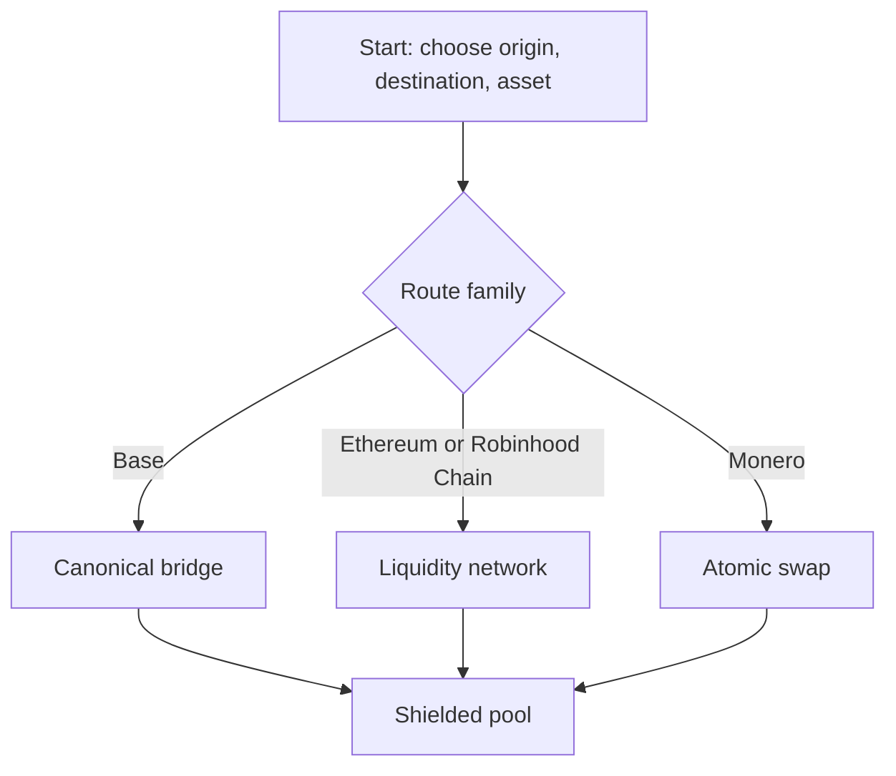

# 02 Routes

> Draft. Pre-launch, spec stage. Everything here may change.

## In short

A route is a defined way to move value between an outside chain and the shielded pool. There are three families: a canonical bridge for Base, a liquidity network for Ethereum and Robinhood Chain, and trustless atomic swaps for Monero. All routes share the same lifecycle, so privacy properties are comparable.

## Route table

| Chain | Asset | Route | Speed in | Speed out | Trust notes |
| --- | --- | --- | --- | --- | --- |
| Base | ETH, more later | Canonical bridge | Minutes | Challenge window, or fast exit via liquidity network | Settlement layer security |
| Ethereum | ETH, more later | Liquidity network | Fast | Fast | Relayer liveness |
| Robinhood Chain | ETH only in v1 | Liquidity network | Fast | Fast | Relayer liveness |
| Monero | XMR and ETH | Atomic swap | Depends on confirmations | Depends on confirmations | Timeouts, user online |

Details: [Base](03-route-base.md), [Ethereum and Robinhood Chain](04-route-ethereum-robinhood.md), [Monero](05-route-monero.md).

## The shared lifecycle

1. **Deposit** on the origin. This step is public on the origin chain, as it is today.
2. **Shield.** A commitment enters the Merkle tree. The depositor receives a note.
3. **Transfer** (optional). Private moves inside the pool.
4. **Exit request.** The user proves ownership of a note, publishes its nullifier and names a destination and route.
5. **Arrive.** Funds are released on the destination chain.

Only steps 1 and 5 touch public chains. Observers see that something entered and something left, not which entry matches which exit.

## Why separate route families

Each outside chain offers different security. Base is the settlement layer, so a native bridge is possible. Ethereum and Robinhood Chain are not the settlement layer, so speed comes from independent relayers. Monero has no smart contracts and no timelocks, so it needs a cryptographic swap rather than a bridge.

## Technical details

- Every route exposes the same interface to the pool: a deposit that creates a commitment, and an exit that consumes a nullifier and names a payout.
- Exit payouts are bound to the proof, so a relayer cannot redirect funds.
- Asset support is per route. Robinhood Chain is ETH only in v1.
- Route selection is made by the wallet. The wallet should show the user the trade-off between speed, fee and trust before confirming.

## Open questions

- A common asset registry across routes, and how new assets are added.
- Whether chained routes (for example Monero to Base in one user action) are offered as one flow or composed by the wallet.
- Minimum and maximum amounts per route, and whether denominated deposits improve privacy enough to justify them.
