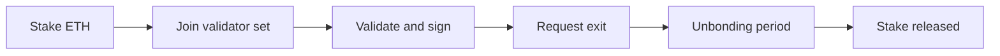

# 02 Validators and staking

> Draft. Pre-launch, spec stage. Roles and penalties below are design proposals. Nothing is decided.

## In short

Validators secure Hash Chain. They stake ETH as a guarantee of good behavior, verify proofs, order updates and finalize them. If a validator breaks the rules in a provable way, part of its stake can be taken. No new token is involved.

## Why ETH stake

Security needs something at risk. ETH is the asset the connected networks already use for value and fees, so staking ETH ties the network's security to an asset that users already hold. Whether this is native ETH stake, restaked ETH, or another form is to be specified.

## Roles

| Role | Job | Status |
| --- | --- | --- |
| Validator | Verify proofs, propose and sign blocks, take part in finality | Design |
| Connection verifier | Check events on connected networks and sign bridge messages | Design |
| Storage node | Keep data available for wallets to scan and recover notes | To be specified |
| Liquidity provider | Front funds on destination networks for fast transfers, repaid later. Not a validator | Design |

A validator may hold several roles. Liquidity providers are independent actors, see [10](10-connections.md).

## Slashing conditions (design)

Stake can be reduced for provable faults:

- **Double signing.** Signing two conflicting finalized updates.
- **Invalid verification.** Signing a connection message that does not match the source network.
- **Censorship proofs.** If a way to prove deliberate exclusion exists, it may be penalized. To be specified.
- **Downtime.** Long absence may reduce rewards or stake. Whether it reduces stake is open.

Penalties never reveal user data, because validators never hold it.

## Joining and leaving

The unbonding period exists so faults found after exit can still be penalized. Its length is to be specified.

## Technical details

- **Weight.** Voting weight follows stake. Caps to limit concentration are to be specified.
- **Keys.** Validators use separate keys for signing and for withdrawing stake.
- **Rewards.** Validators are paid from network fees, which are paid in ETH ([12](12-fees.md)). No token is issued.
- **Accountability.** Signed messages must be verifiable by anyone, so evidence of a fault can be submitted by third parties.

## Open questions

- Form of the ETH stake: native, restaked, or another design, and where it is held.
- Validator set size, admission rules and geographic or operator diversity.
- Exact slashing amounts and the process for disputing a penalty.
- Whether storage nodes are separate from validators.
- Governance of parameter changes.
