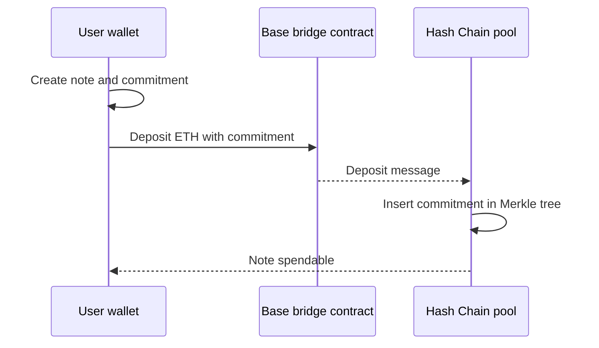
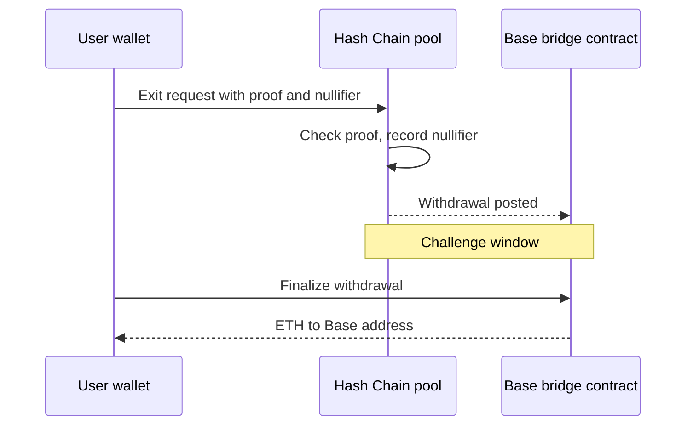

# 03 Base route

> Draft. Pre-launch, spec stage. Everything here may change.

## In short

Hash Chain settles on Base, so Base uses the canonical bridge. Deposits arrive in minutes. A standard withdrawal waits out the challenge window, about seven days, and a fast exit through the liquidity network is available for users who prefer speed and pay a relayer fee.

## Deposit

You send ETH from a public Base address to the bridge contract and attach a commitment to a new note. After the deposit is recognized on Hash Chain, the commitment appears in the pool and you hold a shielded note.

## Standard withdrawal

You prove ownership of a note, publish its nullifier and name a Base address. The withdrawal is initiated on Hash Chain, waits out the challenge window, and is then finalized on Base, where the funds are released to your address.

## Fast exit

Instead of waiting, a relayer fronts ETH to your Base address immediately and takes over your claim on the pending withdrawal. The relayer is repaid through the canonical path when the window ends. See [04](04-route-ethereum-robinhood.md) for the liquidity network. You pay a relayer fee for this convenience.

## Privacy properties

- The deposit shows an address, an amount and a commitment on Base. The commitment reveals nothing about the note's later use.
- The withdrawal shows a destination address and an amount. It does not show which deposit it spends.
- Linkage risk comes from timing and amounts. A deposit of an unusual amount followed by an identical withdrawal soon after is easy to guess. See [09](09-security-and-trust.md).

## Technical details

- **Deposit finality.** Hash Chain should wait for the deposit to reach a defined finality level on Base before inserting the commitment. The level is to be specified.
- **Challenge window.** A parameter, about seven days at the draft stage. Its mechanism is tied to the settlement design in [01](01-architecture.md).
- **Withdrawal binding.** The recipient address and amount are public inputs of the proof ([06](06-shielded-transfers.md)), so no one can change them in flight.
- **Forced inclusion.** If the sequencer censors an exit request, the user should be able to submit it through Base. This is a design goal.

## Open questions

- The finality level required before a deposit counts.
- Whether deposits can be batched to improve privacy.
- Exact fast-exit pricing model and how a relayer inherits the withdrawal claim safely.
- Support for assets other than ETH on this route.
