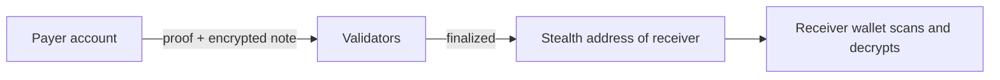

# 04 Private payments

> Draft. Pre-launch, spec stage. Interfaces are descriptive and may change.

## In short

Send ETH and stablecoins without publishing the amount, the sender or the receiver. Receivers get a fresh stealth address for every payment. On top of plain transfers, Hash Chain is designed to support payment links, batch payouts and merchant checkout, all private by default.

## Payment types

- **Direct transfer.** One account pays another. The receiver's wallet finds the note by scanning.
- **Payment link.** A link carries a request (asset, amount, memo). Whoever opens it pays to a fresh stealth address. No account address is exposed in advance.
- **Batch payout.** One update pays many recipients, for example payroll or supplier runs. Recipients do not see each other, and observers see nothing.
- **Merchant checkout.** A merchant creates an invoice. The customer pays privately. The merchant can prove receipt with a credential ([08](08-proofs-and-view-keys.md)).



## Assets

ETH is the first asset. Stablecoins arrive through the connections in [10](10-connections.md). Which stablecoins and in what order is to be specified.

## Settlement

Payments are designed to settle in moments through fast deterministic finality ([01](01-architecture.md)). Because accounts have separate chains, a busy merchant does not slow down unrelated payers.

## Technical details

- **Payment request (draft).**

```ts
// DRAFT. Descriptive, not normative.
interface PaymentRequest {
  assetId: string;
  amount?: bigint;          // optional, payer may choose
  receivingKey: string;     // long-lived key used to derive stealth addresses
  memoCommitment?: string;  // hash of a private memo
  expiresAt?: number;       // unit and rules to be specified
}
```

- **Batch update.** A single proof covers many outputs. The maximum outputs per update is to be specified.
- **Memos.** Encrypted to the receiver only.
- **Fees.** Paid in ETH, see [12](12-fees.md).

## Open questions

- Maximum outputs in one batch and the effect on proof cost.
- How merchants reconcile invoices with payments without leaking links.
- Refund and chargeback flows that do not expose the payer.
- Recurring payments and subscriptions.
