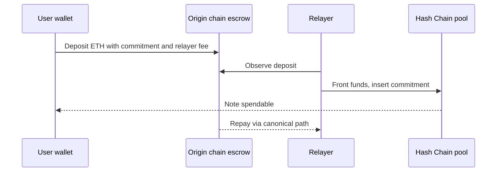
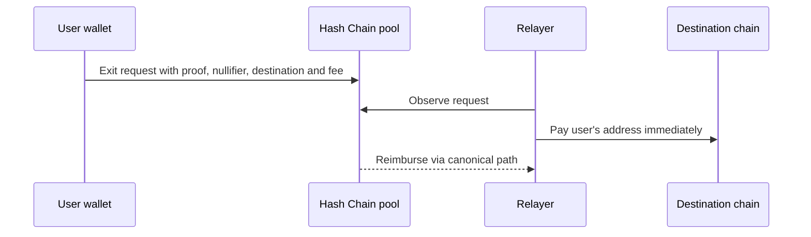

# 04 Ethereum and Robinhood Chain routes

> Draft. Pre-launch, spec stage. Everything here may change. Statements about relayers describe design intent, not audited facts.

## In short

Ethereum and Robinhood Chain connect to Hash Chain through a liquidity network. Independent relayers, also called solvers, front funds on the destination chain quickly and are repaid later through the canonical path. The design intent is that a relayer can delay a transfer but cannot steal it. On Robinhood Chain, only ETH is supported in v1.

## How it works in plain words

Moving funds the canonical way can be slow. A relayer with spare liquidity on the destination chain pays you straight away, and then collects the corresponding funds from the slower official path. You pay a fee for that service. If no relayer picks up your request, you can still use the canonical path and wait.

## Into Hash Chain from Ethereum or Robinhood Chain

The relayer inserts the commitment on Hash Chain before the canonical message arrives, and is later repaid from the origin escrow. If no relayer acts, the canonical message eventually inserts the commitment.

## Out of Hash Chain to Ethereum or Robinhood Chain

## Why relayers cannot steal (design intent)

- The recipient address and amount are public inputs of the exit proof, so a relayer cannot change them.
- A relayer is reimbursed only by presenting evidence that it paid the named recipient.
- The user's funds are never held by a relayer. A relayer risks its own liquidity.
- If a relayer fails to act, the canonical path remains.

What a relayer can do: refuse, be slow, or compete on fee. That is delay, not theft. This is a design claim to be verified through review and audits.

## What relayers see

A relayer sees the public parts of a request: the destination address, the amount and the fee. It does not see which note is being spent. Choose fresh destination addresses.

## Technical details

- **Asset scope.** Ethereum: ETH, further assets to be specified. Robinhood Chain: ETH only in v1, other assets later.
- **Relayer competition.** Requests are public so that any relayer can fill them. A fee auction or fixed schedule is to be specified.
- **Evidence of payment.** The destination chain payout must be provable to the reimbursement contract. The method per chain is to be specified.
- **Liquidity risk.** A relayer carries inventory risk and timing risk until reimbursement. This is priced into the fee.

## Open questions

- Relayer bonding or reputation, and whether either is needed.
- How a request that no relayer fills is surfaced to the user, and when the wallet suggests the canonical path.
- Rate limits and size limits to protect thin liquidity.
- How the Robinhood Chain canonical path is verified from Hash Chain.
