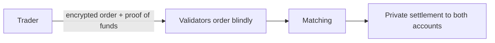

# 05 Private swaps

> Draft. Pre-launch, spec stage. Matching design is undecided and listed under open questions.

## In short

Hash Chain is designed to include a native exchange layer. Trades, sizes and wallets are hidden, so nobody can front-run an order or copy a trader. The same layer is where Monero atomic swaps find their counterparties.

## The problem with public swaps

On a public chain, a pending order is visible. Others can trade ahead of it, sandwich it, or copy a wallet they have identified as profitable. Hiding order flow removes these attacks at the source.

## What stays hidden

- Who is trading.
- How much they trade.
- Which side they take, until the trade is final, and in some designs even afterwards.
- The link between a trader's account and their other activity.

What may be public is a result such as aggregate volume or a price, if the design chooses to publish one. That choice is to be specified.

## Front-running resistance

Orders are submitted as encrypted commitments with proofs that the trader owns the funds. Validators order and finalize them without reading contents. Since validators cannot see an order, they cannot trade ahead of it. Fairness of ordering is a separate question, see open questions.



## Matching design options

None of these is chosen.

| Option | Idea | Trade-off |
| --- | --- | --- |
| Batch auction | Collect orders for a period, clear at one price | Fair and simple, but traders wait |
| Encrypted order book | Orders matched on encrypted data by a committee | Familiar, but needs threshold decryption or similar |
| Peer-to-peer matching | Counterparties found off network, settled on Hash Chain | Simple, weaker price discovery |
| Curve-based market maker | Liquidity held privately, price from a curve | Easy to use, but private curve state is hard |

## Monero swaps

Native atomic swaps with Monero are described in [11](11-connection-monero.md). Counterparty discovery for those swaps reuses this layer where possible.

## Technical details

- **Order (draft).**

```ts
// DRAFT. Descriptive, not normative.
interface PrivateOrder {
  pair: string;               // asset pair identifiers
  side: "buy" | "sell";       // hidden inside the commitment
  limitPrice: bigint;         // hidden inside the commitment
  amount: bigint;             // hidden inside the commitment
  fundsProof: string;         // proof the account owns the input notes
  commitment: string;
}
```

- **Settlement.** Matched trades spend each side's input notes and create output notes in one atomic update covering both accounts.
- **Fees.** Paid in ETH ([12](12-fees.md)).

## Open questions

- Which matching design to use, or whether to support several.
- Who is allowed to decrypt or match, and how a committee is chosen and held accountable.
- Ordering fairness: how to stop validators from reordering encrypted orders to their benefit through timing or metadata.
- What aggregate data, if any, is published for price discovery.
- Handling of partial fills without leaking sizes.
