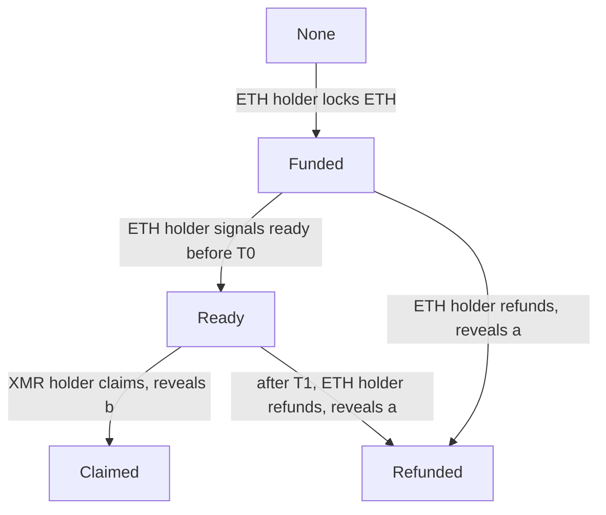
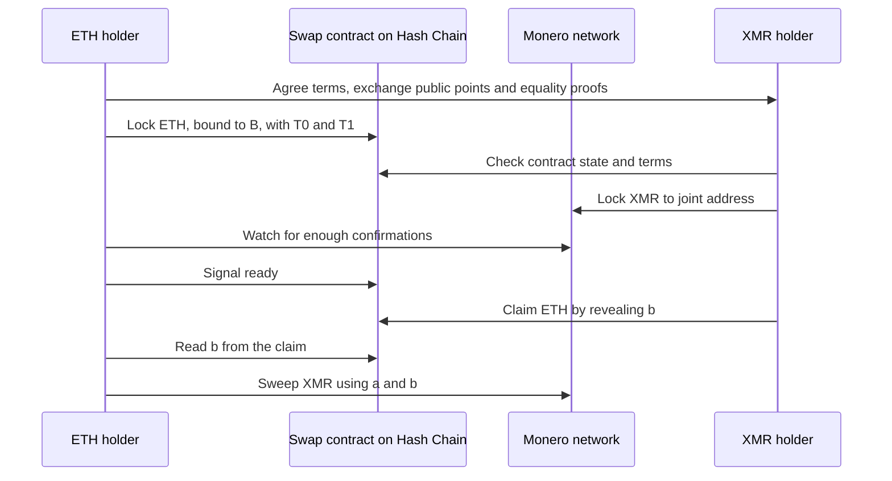

# 05 Monero route

> Draft. Pre-launch, spec stage. The protocol below is a design sketch, not a final or audited specification. Cryptographic details marked "to be specified" are undecided.

## In short

Monero connects to Hash Chain through trustless atomic swaps between XMR and ETH. The ETH side is locked in a swap contract on Hash Chain and the XMR side is locked to an address controlled by a key split between the two parties. By design, no party can end up with both sides, and no custodian ever holds the funds. The costs of failure are mostly delay and the need to stay online, described below.

## Why a swap and not a bridge

Monero has no smart contracts and no native timelocks, so a contract on Hash Chain cannot hold or release XMR. A bridge would need a custodian or a federation to hold XMR. An atomic swap avoids that: two people exchange assets directly, and cryptography makes the exchange all or nothing.

## Roles

- **ETH holder.** Holds ETH on Hash Chain and wants XMR. Holds secret scalar `a`, public point `A`.
- **XMR holder.** Holds XMR and wants ETH on Hash Chain. Holds secret scalar `b`, public point `B`.

A user may take either role. The counterparty is a swap participant found through a market mechanism that is to be specified. The counterparty earns a swap fee ([08](08-fees.md)).

## Building blocks

- **Joint address.** The XMR is locked to an address whose spend key is `A + B`. Neither party can spend alone. Whoever learns both `a` and `b` can spend by themselves with an ordinary Monero transaction. The view key is shared so both can verify the lock.
- **Adaptor secret.** The ETH claim is bound to the point `B`. Claiming the ETH requires publishing the scalar `b`. That publication is what lets the ETH holder learn `b`, and it is called revealing the adaptor secret.
- **Equality proof.** Each party proves that the scalar behind its Monero-side point equals the scalar behind its Hash-Chain-side point. This is a cross-curve discrete logarithm equality proof. The exact construction is to be specified.
- **Timeouts.** Two deadlines on Hash Chain time, `T0` and `T1`, with `T0` earlier than `T1`.
  - `T0`: the deadline by which the ETH holder must signal that the XMR lock is confirmed. Without that signal by `T0`, the swap is treated as cancelled and only a refund is possible.
  - `T1`: the deadline for the XMR holder to claim after the signal. After `T1`, the ETH holder may refund.

Neither deadline is a number here. Their lengths are parameters to be specified, large enough for Monero confirmations and for a user to come back online.

## Contract states

Rules in words:

1. In `Funded`, the ETH holder may refund at any time. Refunding publishes `a`.
2. In `Funded`, the ETH holder may signal ready, only before `T0`.
3. In `Ready`, only the XMR holder may claim, until `T1`. Claiming publishes `b`.
4. In `Ready`, after `T1`, the ETH holder may refund. If the XMR holder has not yet claimed, whichever valid action reaches the contract first wins.
5. `Claimed` and `Refunded` are final.

## Happy path

## Direction 1: ETH to XMR (user is the ETH holder)

1. The user and the counterparty agree on the amounts, fee, `T0` and `T1`, exchange public points and equality proofs, and each verifies the other's proof.
2. The user locks ETH in the swap contract. The wallet stores `a` safely before this step.
3. The counterparty checks the contract and locks XMR to the joint address.
4. The wallet watches Monero. When the lock has the required confirmations, matches the agreed amount and goes to the correct joint address, it signals ready before `T0`.
5. The counterparty claims the ETH, which publishes `b`.
6. The wallet reads `b` and sweeps the XMR to the user's own Monero address using `a` and `b`.

If something stops: the user refunds. Refunding publishes `a` so the counterparty can recover any XMR they locked.

## Direction 2: XMR to ETH (user is the XMR holder)

1. The user and the counterparty agree on terms and exchange points and proofs.
2. The counterparty, who holds the ETH, locks it in the swap contract first. The user's wallet verifies the contract state, amounts, `B` and the deadlines.
3. The user locks XMR to the joint address. The wallet stores `b` safely before this step.
4. The counterparty confirms the XMR lock and signals ready before `T0`.
5. The user claims the ETH before `T1`, to a shielded destination on Hash Chain, which publishes `b`.
6. The counterparty reads `b` and sweeps the XMR.

If something stops: if the counterparty refunds, `a` becomes public and the user sweeps the locked XMR back using `a` and `b`. The user must come back online to do so. There is no expiry on the Monero side.

## Failure matrix

| When | Who goes offline or misbehaves | Outcome |
| --- | --- | --- |
| Terms agreed, before any lock | Either | Nothing at stake. Swap does not start. |
| After ETH lock, XMR never locked | XMR holder disappears | ETH holder refunds and publishes `a`. No loss. |
| After both locks, before ready | ETH holder offline | ETH and XMR stay locked and nobody can steal either. When the ETH holder returns, they either signal ready before `T0` or refund. After `T0` only refund is possible, and the XMR holder recovers by sweeping with `a` and `b`. Until the ETH holder acts, the XMR holder has no way to recover and no guaranteed recovery time. A deliberately absent ETH holder can therefore freeze the XMR holder's funds (a griefing risk, see open questions). |
| After ready, before claim | XMR holder offline | After `T1` the ETH holder refunds. XMR holder later sweeps their XMR back using `a` and `b`. Swap fails, no loss. |
| After ready, XMR holder claims | ETH holder offline | Claim publishes `b`. ETH holder sweeps whenever they return, using stored `a`. No deadline on Monero. |
| After claim | XMR holder offline | Nothing further is needed from them. |
| ETH holder signals ready on a bad or missing XMR lock | ETH holder error, or XMR holder lies | XMR holder can claim ETH and the ETH holder finds no XMR. This is the main user-side risk. The wallet must verify the lock automatically. |
| A user loses their secret (`a` or `b`) | Either | The funds that depend on it can become unrecoverable. Wallets must back up the secret before the first lock. |
| Hash Chain sequencer censors or halts | Infrastructure | Deadlines are measured on Hash Chain time. Forced inclusion via Base is a design goal. A long halt may cause a refund, not a theft. |
| Monero chain reorganization | Infrastructure | Wait for enough confirmations before signalling ready. |
| Both parties offline | Both | Funds remain in their locked state until someone returns. |

## Privacy properties

- On Monero, the swap looks like an ordinary transfer to a one-time address. The joint address is not linkable to either party by itself.
- On Hash Chain, the ETH lock and the claim are visible on the swap contract. For privacy, the lock should be funded from the shielded pool and the claim should pay into the pool. The exact mechanism for funding the lock without linking is to be specified.
- Amounts and timing of the swap leak to the counterparty. Choose counterparties and amounts with that in mind.

## Technical details

- **Curves.** Monero uses Ed25519. The EVM can verify secp256k1 points cheaply through existing primitives. The design binds one scalar to a point on each curve with a DLEQ-style proof.
- **Claim check.** The swap contract accepts a claim only if the published scalar matches the committed point `B` on the Hash Chain side.
- **Refund check.** Likewise for `a` and `A`.
- **Monero spend.** Once a party knows both `a` and `b`, the joint key is a normal single key. The sweep is a standard Monero transaction.
- **Confirmation count.** A parameter for the wallet and counterparty, to be specified.
- **Persistence.** Wallets must persist swap state and secrets so that a crashed client can resume or refund.

## Open questions

- The exact cross-curve proof and the assurance level needed.
- Counterparty discovery: an order book, quote requests, or a set of swap providers, and how fees are set.
- How to fund the ETH lock from shielded notes and claim into shielded notes without leaking a link.
- Timeout lengths, and how wallets warn users about the need to be online.
- Whether the signal-ready step can be replaced by something that needs less online presence from the ETH holder.
- Griefing: how to stop a counterparty from freezing an XMR holder's funds by going silent, for example through a bond, a reputation system, or a design where the XMR holder locks first.
- Watchtowers: whether an optional service can submit refunds or sweeps on behalf of an offline user without learning secrets.
