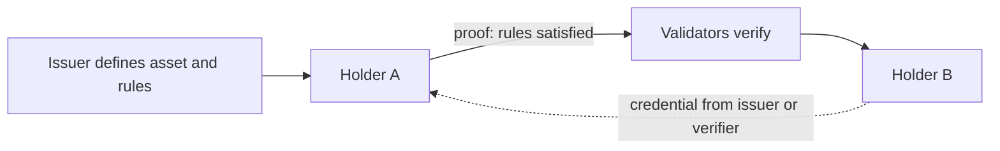

# 06 Private assets

> Draft. Pre-launch, spec stage. Everything here is a design and may change.

## In short

Issuers can create assets on Hash Chain, and holders keep private balances of them. Rules such as who may hold or transfer an asset are enforced by proofs, so an issuer can meet legal requirements without seeing every balance. Stablecoins and tokenized stocks are examples of what this is for.

## Issuing an asset

An issuer defines an asset: its identifier, supply rules and transfer rules. The definition is public. Balances and transfers of the asset are private, like any other note.

## Transfer rules enforced by proofs

A rule is a statement the sender's proof must satisfy. Examples:

- The receiver holds a credential that says they passed the issuer's checks ([08](08-proofs-and-view-keys.md)).
- The transfer keeps the holder under a cap.
- The asset is not sent to a blocked account.

The proof shows the rule was met without revealing who the parties are or how much moved. The issuer sees the rule is enforced, not the data.



## Examples

- **Stablecoins.** Private balances and payments of a stablecoin, with issuer rules where required.
- **Tokenized stocks.** Holders keep positions private. Eligibility rules, such as holder jurisdiction, are credentials checked in the proof. Tokenized assets from Robinhood Chain are planned to arrive later ([10](10-connections.md)).
- **Other real-world assets.** Same pattern, with rules set by the issuer.

Naming an example does not mean any specific asset or issuer is committed to.

## Technical details

- **Asset definition (draft).**

```ts
// DRAFT. Descriptive, not normative.
interface AssetDefinition {
  assetId: string;
  issuerKey: string;
  supplyRule: "fixed" | "issuer-minted";
  transferRules: RuleRef[];       // references to circuits or credential checks
  auditKey?: string;              // optional key for scoped issuer disclosure
}
```

- **Rule circuits.** Each rule maps to part of the proof statement. The set of supported rules is to be specified.
- **Minting and burning.** Issuer actions are public events in amount only where the design requires it. To be specified.
- **Fees.** In ETH ([12](12-fees.md)).

## Open questions

- Whether the total supply of an asset is public, and how it is shown without revealing balances.
- How issuers revoke or freeze holdings, and what that does to privacy.
- Legal and regulatory fit varies by jurisdiction and asset. This spec takes no position.
- How credentials are issued, renewed and revoked at scale.
