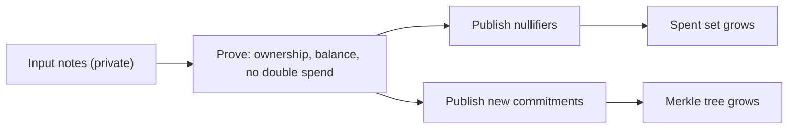

# 06 Shielded transfers

> Draft. Pre-launch, spec stage. All structures below are drafts and descriptive, not normative.

## In short

Inside Hash Chain, value is held as private notes. A transfer destroys some notes and creates new ones, and a zero-knowledge proof shows that the transfer is valid without revealing the amounts or the parties. Nullifiers prevent the same note from being spent twice.

## The model

Think of the pool as a box of sealed envelopes.

- A **note** is an envelope with a value and an owner inside.
- A **commitment** is a public fingerprint of an envelope. The pool lists every fingerprint, but nobody can read what is inside.
- A **nullifier** is a one-time stamp you publish when you open an envelope to spend it. The stamp cannot be linked back to the fingerprint, but it cannot be used twice.
- A **proof** convinces everyone that you opened a real envelope that you own, that the new envelopes hold exactly the same total value, and that you did not reuse the stamp.

This is a UTXO-style model, like cash. A transfer consumes inputs and creates outputs.

## Stealth addresses

A receiver publishes a long-lived receiving key. A sender derives a fresh one-time address from it for each payment. Observers cannot see that two payments went to the same person. The receiver scans new notes with a private scanning key and finds those meant for them.

## Transfer flow



## Technical details

### Draft data structures

```ts
// DRAFT. Names and field sizes are placeholders.

interface Note {
  value: bigint;          // amount in smallest unit of the asset
  assetId: Field;         // which asset
  ownerKey: Field;        // one-time receiving public key (from a stealth address)
  blinding: Field;        // random value that hides the note
}

// commitment = Hash(value, assetId, ownerKey, blinding)
type Commitment = Field;

// nullifier = Hash(nullifierKey, commitment, leafPosition)
// Unique per note, unlinkable to its commitment without the nullifier key.
type Nullifier = Field;

interface MerkleTree {
  depth: number;          // to be specified
  hash: "to be specified"; // a hash friendly to zero-knowledge circuits
  root: Field;
  insert(c: Commitment): number;   // returns leaf position
}
```

### Public inputs of a transfer proof

```ts
// DRAFT.
interface TransferPublicInputs {
  merkleRoot: Field;                 // a recent valid root
  nullifiers: Nullifier[];           // one per input note
  newCommitments: Commitment[];      // one per output note
  publicValueIn: bigint;             // nonzero on deposit, else 0
  publicValueOut: bigint;            // nonzero on exit, else 0
  assetId: Field;
  exitRecipient?: string;            // bound to the proof on exit
  relayerFee?: bigint;               // bound to the proof when a relayer is used
  extDataHash: Field;                // binds encrypted payloads and fees
}
```

### Statement proven

For public inputs above, the prover knows private witnesses (input notes, their Merkle paths, spending keys, output blinding) such that:

1. Each input commitment is in the tree under `merkleRoot`.
2. The prover knows the key authorizing each input.
3. Each `nullifier` is correctly derived from its input.
4. Each output commitment is correctly formed.
5. Sum of input values plus `publicValueIn` equals sum of output values plus `publicValueOut`, per asset, with no overflow.
6. Fee and recipient fields are bound to the proof so they cannot be altered.

### Pool contract behavior

- Reject a proof if any nullifier is already in the spent set.
- Reject a proof if `merkleRoot` is not among recent known roots.
- On success, add nullifiers to the spent set, append commitments to the tree, and move public value if any.

### Proving system

The proving system, the circuit-friendly hash, the tree depth and whether a trusted setup is required are all **to be specified**. If a setup ceremony is used, its design and participation rules will be published before any mainnet use. See [09](09-security-and-trust.md).

### Encrypted note payloads

Each output carries an encrypted payload so the receiver can recover the note. Where payloads are stored is covered in [01](01-architecture.md).

## Open questions

- Proving system choice and trusted setup decision.
- Number of inputs and outputs per transfer, and the effect on the anonymity set and fees.
- Multi-asset notes versus per-asset pools.
- Whether the pool supports compliance-friendly features beyond view keys ([07](07-view-keys.md)).
- Root history length and its effect on user experience.
