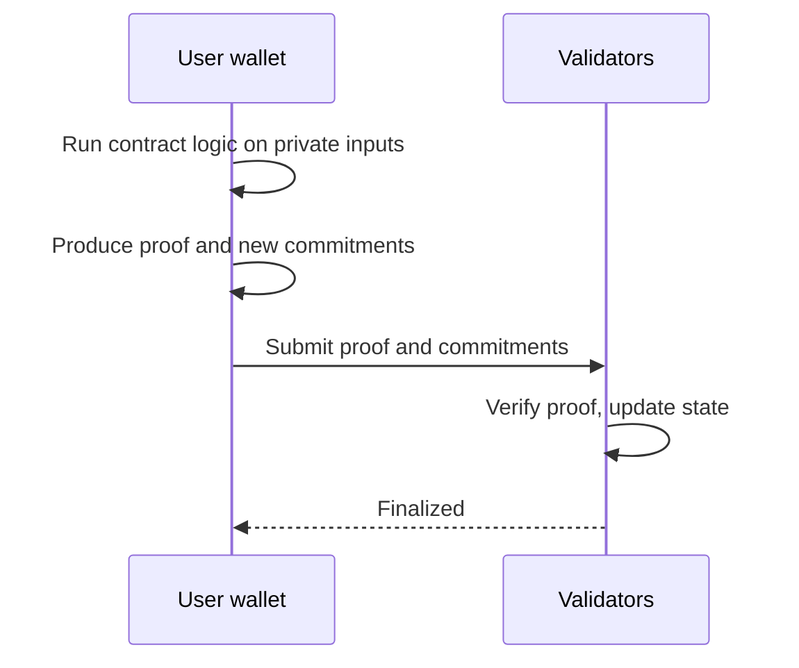

# 07 Private apps

> Draft. Pre-launch, spec stage. The SDK shown below is a preview of an idea. It does not exist yet.

## In short

Builders deploy contracts whose inputs and state stay hidden. Users run the logic on their own device and submit a proof that it was done correctly. Validators check the proof and never see the data. An SDK and APIs are planned so wallets, fintechs and apps can use this without writing cryptography.

## Private contract model

A private contract has two kinds of state:

- **Private state.** Held as encrypted commitments by their owners, like notes.
- **Public state.** Optional values the contract chooses to expose.

A call is executed by the caller's wallet. It produces new state and a proof. Validators verify the proof and update commitments and nullifiers.



Shared private state, where many users touch the same hidden value, is the hard case. See open questions.

## SDK preview

Preview, may change.

```ts
// PREVIEW. May change. Not a published package.
import { HashChain } from "@hashchain/sdk";

const hc = new HashChain({ network: "devnet" });
const account = await hc.accounts.create();

// Private payment
await account.pay({ to: recipientKey, asset: "ETH", amount: 1_000_000n });

// Call a private app contract
const app = hc.apps.connect(appId);
await app.call("placeBid", { auction: auctionId, amount: 500n });

// Prove something without revealing the rest
const proof = await account.prove("balance-at-least", { asset: "ETH", threshold: 100n });
```

## What apps could be

Sealed-bid auctions, private payroll tools, private lending positions, private voting for organizations, and wallet features for fintechs. These are examples of the model, not commitments.

## Technical details

- **Language and circuits.** A contract language that compiles to circuits is to be specified.
- **Proving cost.** Heavier logic means heavier proofs on the user's device. Limits are to be specified.
- **Upgrades.** Whether and how contracts can be upgraded is to be specified.
- **Fees.** In ETH ([12](12-fees.md)).

## Open questions

- Contract language and tooling.
- Shared private state: multi-party computation, a coordinator account, or another approach.
- How apps request disclosure from users ([08](08-proofs-and-view-keys.md)) without over-collecting.
- Testing and audit practices for private contracts.
