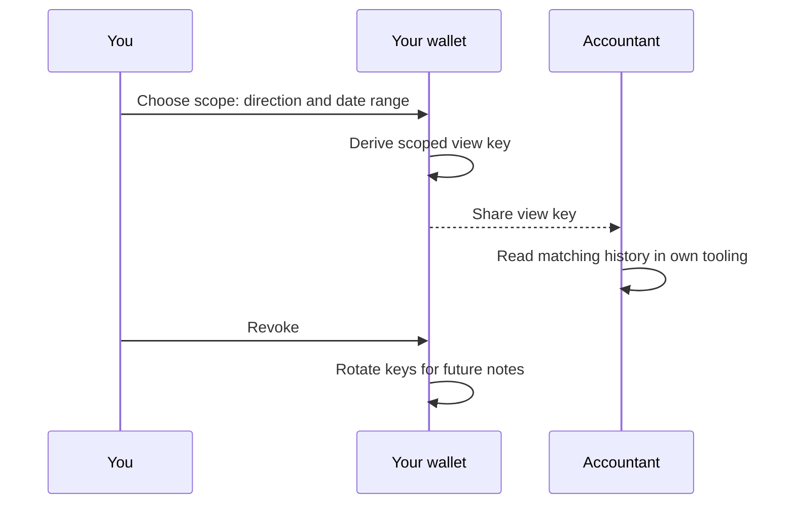

# 07 View keys

> Draft. Pre-launch, spec stage. Everything here may change.

## In short

A view key lets you share read-only visibility into your own history with someone you choose, such as an accountant or an auditor. It cannot move funds. You can limit what it shows and revoke it later. Privacy is the default, disclosure is your decision.

## Why this exists

Privacy and accountability are not opposites. A business needs to show its books to an auditor without publishing them to the world. A person needs to prove income to a tax authority without exposing everything to strangers. View keys make that possible. The positioning is private, not shady.

## What a view key can reveal

Scopes are chosen when the key is created:

- **Incoming only**, **outgoing only**, or both.
- A **date range**, so only a period such as a tax year is visible.
- Optionally limited to certain assets or accounts.

A view key never grants spending power.

## How sharing works

## Revocation, honestly

Revocation stops **future** visibility: notes created after the revocation use fresh keys that the old view key cannot read. Data that the holder already viewed cannot be unseen. If you shared a view key and the holder saved a report, revoking does not delete the report. Share only with people you trust and only for the scope they need.

## Technical details

- **Key hierarchy (draft).** A master secret derives a spending key, a nullifier key and one or more view keys. A view key can decrypt note payloads but cannot derive the spending or nullifier key.
- **Scoping.** Scope by direction is achieved by separate incoming and outgoing view keys. Scope by date range is achieved by deriving keys per epoch, so a holder given a range receives only the epoch keys inside it.
- **Revocation.** Because epoch keys are derived forward, revocation means no further epoch keys are shared and the wallet moves future activity to a new branch. It cannot reach into the past.
- **Spent-state limitation.** A holder who can see a note can also compute when it is spent only if the scheme allows deriving its nullifier. Whether outgoing visibility reveals nullifiers is to be specified.
- **Limits.** A view key shows your activity on Hash Chain. It does not show activity on other chains unless that activity touches the pool.

## Open questions

- The exact derivation tree and the granularity of epochs.
- Whether a view key can be bound to a named recipient to discourage resale.
- Optional signed reports so an auditor can attest to what they saw.
- Wallet user experience for choosing scopes without mistakes.
