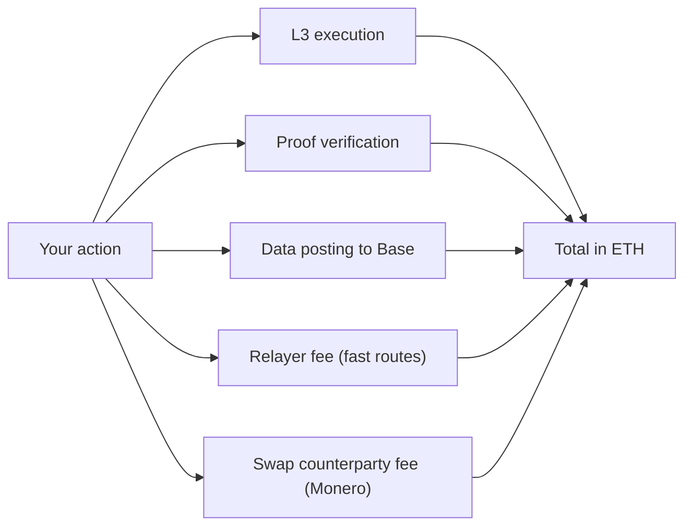

# 08 Fees

> Draft. Pre-launch, spec stage. No fee values are set. This document describes what fees exist, not how large they are.

## In short

Everything is paid in ETH. A fee is built from a few parts: running your transaction on Hash Chain, checking the privacy proof, posting data to Base, and, on some routes, paying a relayer or a swap counterparty. Which parts apply depends on the route.

## Fee components

| Component | What it pays for | Applies to |
| --- | --- | --- |
| L3 execution | Running the transaction on Hash Chain | All actions |
| Proof verification | Checking the zero-knowledge proof on-chain | Shielded transfers, exits |
| Data posting to Base | Storing Hash Chain data on its settlement layer | All actions, shared across a batch |
| Origin or destination chain gas | The public transaction on the other chain | Deposits and exits |
| Relayer fee | Fronting funds for fast routes | Ethereum, Robinhood Chain, Base fast exit |
| Swap counterparty fee | The party on the other side of a Monero swap | Monero routes |

## What affects each part

- Demand on Hash Chain, Base and the other chain.
- Size and complexity of the proof. More inputs and outputs mean more to verify.
- How much data must be posted.
- For relayers: the amount, the destination chain, and the time until repayment.
- For swaps: the size of the swap, the market for counterparties and the cost of waiting for confirmations.

## What you see

A wallet should show the total fee in ETH before you confirm, broken down by component, together with the route's speed and trust trade-offs. For fast routes the wallet should show the standard path as an alternative.

## Technical details

- **Gas token.** ETH. There is no separate gas token.
- **Fee binding.** A relayer fee is a public input of the proof ([06](06-shielded-transfers.md)). It cannot be changed after you sign.
- **Batching.** Data posting costs may be shared across many transactions. Batching rules are to be specified.
- **Fee privacy.** Paying fees must not link identities. Fee payment from inside the pool, rather than from a public address, is a design goal.
- **Protocol fee.** Whether the protocol itself takes any fee is to be specified.

## Open questions

- Whether any protocol-level fee exists and what it funds.
- Relayer fee discovery: quoted, auctioned or scheduled.
- How a user without public ETH on Hash Chain pays for their first action privately.
- Subsidy or sponsorship models, and what they would leak.
