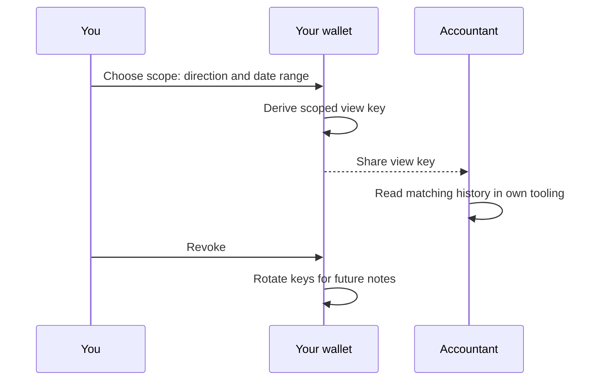
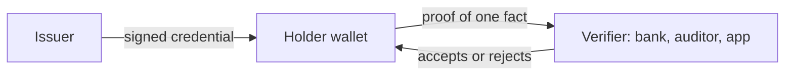
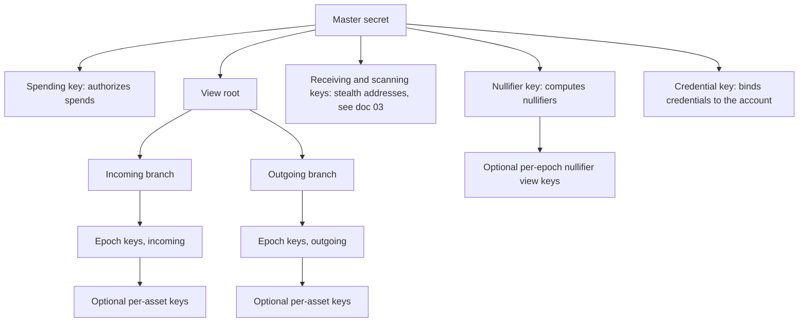

# 08 Proofs and view keys

> Draft. Pre-launch, spec stage. Everything here may change.

## In short

Hash Chain is private by default, and you decide what to prove and to whom. Two tools do this. A **view key** lets you share read-only visibility into your own history. A **credential** lets you prove one fact, such as a balance threshold or an identity attribute, without showing anything else. Private, not shady.

A view key lets you share read-only visibility into your own history with someone you choose, such as an accountant or an auditor. It cannot move funds. You can limit what it shows and revoke it later. Privacy is the default, disclosure is your decision.

## Why this exists

Privacy and accountability are not opposites. A business needs to show its books to an auditor without publishing them to the world. A person needs to prove income to a tax authority without exposing everything to strangers. View keys make that possible. The positioning is private, not shady.

## What a view key can reveal

Scopes are chosen when the key is created:

- **Incoming only**, **outgoing only**, or both.
- A **date range**, so only a period such as a tax year is visible.
- Optionally limited to certain assets or accounts.

A view key never grants spending power.

## How sharing works



## Revocation, honestly

Revocation stops **future** visibility: notes created after the revocation use fresh keys that the old view key cannot read. Data that the holder already viewed cannot be unseen. If you shared a view key and the holder saved a report, revoking does not delete the report. Share only with people you trust and only for the scope they need.

## Credentials and selective disclosure

A credential is a signed statement from an issuer about an account, for example "passed an identity check" or "resident of a given region". The holder keeps it private and uses it inside proofs.

What a user can prove, to whom they choose:

- **History.** That a set of payments happened, to an auditor or tax authority.
- **Balance threshold.** That the balance is at least a value, without giving the balance.
- **Identity attribute.** That a credential from an accepted issuer exists, without giving the identity.
- **Source of funds.** That funds came from an account with a given credential.



The verifier learns the fact, nothing more. Asset transfer rules in [06](06-private-assets.md) use the same mechanism.

## Technical details

All of this is draft. It describes intent and shape, not final cryptography. Related issue: view key hierarchy and credential format (#4).

### Key derivation tree

A wallet holds one master secret on the user's device. Everything else is derived from it one way, so a derived key never reveals its parent.



Rules of the tree:

- **One way.** A key lower in the tree cannot be used to compute a key higher up or a sibling. In particular no view key can derive the spending key or the nullifier key.
- **Domain separation.** Every derivation uses a distinct label (for example "view/incoming/epoch"), so a key made for one purpose is useless for another.
- **Branch index.** The view root carries a counter. Rotating to a new counter creates an unrelated view tree, which is how a wallet moves on after sharing too much (see revocation).
- **Spending is never derivable.** Spending needs the spending key and, to publish a valid nullifier, the nullifier key. Neither is below the view root.

### Epochs

An epoch is a fixed span of Hash Chain time, counted from zero. The unit and length are to be specified. A calendar-aligned span such as a day is the leading candidate, because users think in tax years and quarters, not in blocks. Each note records the epoch in which it was created, and the proof binds that epoch to a value close to the epoch of finalization so a sender cannot mislabel it.

Epoch keys are derived independently from the branch, not as a hash chain. If they were chained forward, a key for epoch 10 would also open epochs 11 and later, and nothing could be shared safely. With independent epoch keys, sharing epoch 10 gives nothing about epoch 11.

To share a range such as a tax year without sending 365 keys, the epochs sit at the leaves of a binary tree of derived seeds. A small set of inner nodes (a few dozen at most for any range) covers exactly the requested range and nothing else. This is the same idea as a tree-based pseudorandom function.

### Incoming and outgoing visibility

- **Outgoing.** The sender knows everything about its own transfers. Each output also carries a short copy of its details encrypted to the sender's outgoing epoch key. An outgoing view key therefore opens the sender's own history for that epoch.
- **Incoming.** The recipient is not known to the sender as a key tree, only as a public receiving key. For epoch scoping to work, the sender must encrypt a disclosure copy to an epoch-specific public key of the recipient. Two candidate mechanisms: (a) the receiving key bundle carries a rolling window of upcoming epoch public keys that the wallet refreshes, or (b) a single scanning key is used and range scoping is done by proof instead of by key. Option (a) gives real key-level scoping but requires wallets to keep bundles fresh. Which one is used is undecided. Public (non-hardened) derivation of epoch public keys is deliberately not proposed, because a leaked child secret combined with the parent public key can reveal the parent secret.
- **Scanning key.** The key a wallet uses to find its own notes ([03](03-accounts-and-private-transfers.md)) is not shared as a view key, because it covers all time.

### Disclosure levels

| Level | Holder can | Holder cannot |
| --- | --- | --- |
| Payment proof | Confirm a single transfer happened, with amount and parties as chosen | See anything else |
| Incoming view key (range) | Read all notes received in the covered epochs | See what was spent, or any other epoch |
| Outgoing view key (range) | Read all transfers sent in the covered epochs | See what was received |
| Incoming plus nullifier view key (range) | Also tell which received notes were spent | Spend, or see other epochs |
| Balance or threshold proof | Check a balance or a bound on it at a point in time | See any history |

The nullifier view key is optional. A nullifier is computed from the nullifier key and the note. If the nullifier key is itself derived per creation epoch, giving out the key for epoch e reveals the spent status of notes created in e and nothing else. Without it, a holder of an incoming key sees what came in but cannot tell what has since left, so a balance claim needs either this key or a balance proof. Whether the extra complexity is worth it is open.

Completeness comes for free. A holder scanning an epoch with a valid key can check the chain for themselves, so the account owner cannot hide a note from them by omission, only by not sharing the key.

### Credential structure

```ts
// DRAFT. Descriptive, not normative.
interface Credential {
  version: number;
  issuerKey: string;               // identifies the issuer; must be in the verifier's accepted set
  schemaId: string;                // names the attribute layout, e.g. "kyc-basic-v1"
  subjectCommitment: string;       // H(credentialPublicKey, blinding): binds to an account without naming it
  attributesRoot: string;          // Merkle root over individual attributes, so each can be shown or hidden alone
  issuedAtEpoch: number;
  expiresAtEpoch: number;          // short expiry is encouraged
  revocationHandle: string;        // random value known to the issuer, used for revocation
  signature: string;               // issuer signature over all fields above; scheme to be specified
}
```

The attributes themselves (for example "over 18", "resident of a region", "passed checks level 2") sit behind `attributesRoot`. The holder keeps the full credential on the device and never sends it. What leaves the device is a proof.

**Presentation.** To use a credential, the wallet produces a proof of this statement: "I hold a credential whose issuer is in this accepted set, whose attribute satisfies this predicate, which has not expired as of epoch e, which is not in the revoked set committed by root R, and which is bound to my account and to this verifier's challenge." The challenge contains the verifier's identity, a purpose string and a fresh nonce, so a proof made for one verifier cannot be replayed to another.

### Credential revocation

The proposed approach has three parts that work together.

1. **Short expiry.** Credentials expire after a modest number of epochs and are reissued. Most invalidation happens by expiry, which needs no list.
2. **Issuer revocation root.** Each issuer maintains a sparse Merkle tree of revoked `revocationHandle` values and publishes its root on Hash Chain on a schedule. A presentation proves non-membership of its own handle against a recent root. The handle is never shown, so verifiers cannot track a holder across presentations, and the public list holds random-looking values, not identities.
3. **Freshness bound.** A presentation is accepted only against a root no older than a window set by the verifier or the asset rule. The gap between revoking and the next published root is the time during which a revoked credential still passes. Issuers choose a schedule, and sensitive uses choose a tight window.

Limits, stated plainly. The issuer can link its own issuance records to handles, since it created them. The public count of revoked handles is visible. A larger revoked set makes proofs slightly more expensive.

### Revoking a view key

- A view key limited to epochs [a, b] stops being useful for new activity by construction: it has no key for epoch b+1.
- For an open-ended share, such as an ongoing audit, the wallet gives out epoch keys in batches and stops giving them when the relationship ends. No further action is needed.
- If a holder was given a key that should not have been given, the wallet increments the view root counter and moves future receiving bundles to the new tree. The old key still opens everything it ever opened. Senders who still use an old bundle keep writing disclosure copies the old key can read, so wallets should retire old bundles quickly.
- Nothing revokes data already read.

### Other points

- **Spent-state limitation.** See the nullifier view key above.
- **Limits.** A view key shows activity on Hash Chain. It does not show activity on other networks unless that activity touches Hash Chain through a connection.
- **Asset rules.** Rules in [06](06-private-assets.md) verify the same presentation proofs, so an issuer of a regulated asset and a bank use one mechanism.

## Open questions

- Which credential issuers are accepted, and who decides.
- Proof-friendly signature scheme for credentials, and whether the selective attribute structure should use a different scheme.
- Epoch length and unit, and the allowed skew between creation epoch and finalization epoch.
- Incoming epoch scoping: rolling public key bundle (a) or proof-based scoping (b).
- Whether the per-epoch nullifier view key is included or left to balance proofs.
- Whether a view key can be bound to a named recipient to discourage resale, for example by encrypting the key to the recipient and requiring signed reports.
- Optional signed reports so an auditor can attest to what they saw.
- Revocation root publication schedule, and the cost of non-membership proofs as revoked sets grow.
- Wallet user experience for choosing scopes without mistakes.
- See also the broader list in [14](14-threat-model.md).
