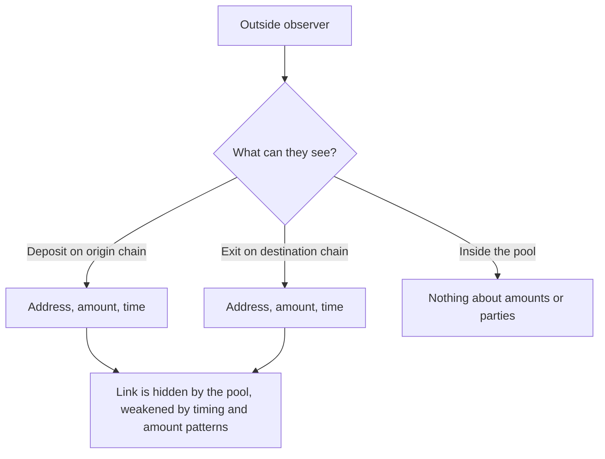

# 09 Security and trust

> Draft. Pre-launch, spec stage. This is a statement of assumptions and risks of the design. Nothing here has been audited.

## In short

Hash Chain reduces what you have to trust, but it does not remove all trust. This document lists what you would be relying on and where privacy can fail, so you can decide with open eyes. Smart contracts are unaudited until the audit phase is complete.

## Trust assumptions

| Area | What you rely on | Design response | Status |
| --- | --- | --- | --- |
| Sequencer liveness and censorship | The sequencer includes your transactions | Forced inclusion through Base as a design goal | Design |
| Prover correctness | The proof system is sound and implemented correctly | Independent review, audits | To be specified |
| Trusted setup | If the proof system needs a setup ceremony, it was run honestly by at least one participant | Choice of system and ceremony design | To be specified |
| Relayer liveness | Some relayer will fill fast-route requests | Canonical path as fallback | Design |
| Swap timeouts and user presence | You come back online within the deadlines to refund or sweep | Wallet reminders, possible watchtowers | Design |
| Anonymity set size | Enough other users to hide among | Grows with usage, cannot be forced | Inherent |
| Metadata | You avoid leaking timing and amounts | User guidance, wallet defaults | Partial |
| Smart contract risk | Contracts have no critical bugs | Audits, staged rollout | Open until audited |
| Upgrade authority | Whoever can upgrade contracts cannot harm users abruptly | Delays long enough to exit | To be specified |

## Privacy limits

**Anonymity set.** Privacy comes from hiding among others. With few users, you hide among few. Early privacy is weaker than later privacy, and the project will say so.

**Metadata leaks.** Cryptography hides what is inside the pool. It does not hide what you do at the edges.

- Depositing an unusual amount and withdrawing the same amount soon after is easy to correlate.
- Entering and exiting at similar times links you by timing.
- Reusing a public address at entry or exit ties activity back to you.
- Network-level data such as your IP address is outside the protocol.

**User advice.** Use fresh destination addresses. Avoid unique amounts. Do not exit immediately after entering. Wait, and split amounts where sensible. Do not announce your activity publicly.

## What the design does and does not protect

## Failure modes by component

- **Sequencer halts or censors.** Users cannot transact until service returns, or until forced inclusion is used. Funds are not lost. Swap deadlines are an extra concern, see [05](05-route-monero.md).
- **Relayer fails.** Fast routes fall back to the canonical path, slower but unchanged in safety.
- **Counterparty fails in a swap.** Refund and sweep paths exist. A silent counterparty can freeze funds for a time.
- **Prover bug.** The most serious class of failure. A soundness bug could allow creation of value or break privacy. Mitigations are review, audits and conservative limits at launch.
- **Contract bug.** Mitigated by audits, staged rollout and limits. Cannot be removed to zero.
- **User error.** Lost spending keys cannot be recovered. Lost swap secrets can strand funds.

## Technical details

- **Double spend.** Prevented by the spent-nullifier set ([06](06-shielded-transfers.md)).
- **Front-running.** Exit recipient and fee are bound to the proof, so a third party cannot redirect or alter them.
- **Replay.** Proofs are bound to the chain and contract instance. Domain separation is to be specified.
- **Roots.** The pool accepts recent roots only. A long history improves usability and makes certain races easier to exploit. Length is to be specified.
- **Disclosure.** View keys disclose only what you choose to share. Revocation is forward-looking ([07](07-view-keys.md)).

## Reporting

See [SECURITY.md](../SECURITY.md) for how to report a design or specification weakness privately.

## Open questions

- Proving system, setup model and ceremony rules.
- Launch limits on deposits and total value, and how they are lifted.
- Emergency pause: who may use it, what it can and cannot do, and how it is made time-limited.
- Anonymity-set measurement and what the wallet tells users about current strength.
- Monitoring and public incident disclosure policy.
