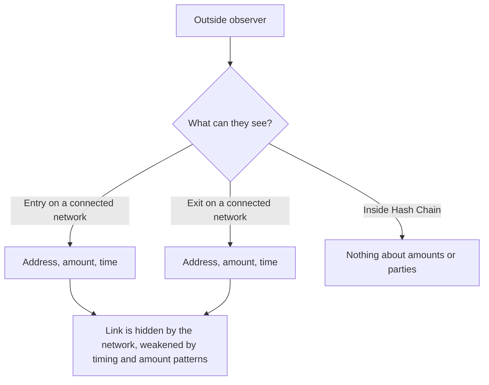

# 09 Security and trust

> Draft. Pre-launch, spec stage. This is a statement of assumptions and risks of the design. Nothing here has been audited.

## In short

Hash Chain reduces what you have to trust, but it does not remove all trust. This document lists what you would be relying on and where privacy can fail, so you can decide with open eyes. Contracts and software are unaudited until the audit phase is complete.

## Trust assumptions

| Area | What you rely on | Design response | Status |
| --- | --- | --- | --- |
| Honest supermajority | More than the required fraction of staked validators follow the protocol | ETH stake, slashing, validator diversity | Design |
| Proof system soundness | The proof system is sound and implemented correctly | Independent review, audits | To be specified |
| Trusted setup | If the proof system needs a setup ceremony, at least one participant was honest | Choice of system and ceremony design | To be specified |
| Connection verification | Validators correctly verify events on Ethereum, Base and Robinhood Chain | Stake behind every signature, bridge contract limits | Design |
| Liveness | Validators keep producing blocks and including your updates | Validator diversity, exit paths on connected networks | Design |
| Liquidity providers | Some provider fills fast transfers | Slower verified path as fallback | Design |
| Swap timeouts and user presence | You come back online within the deadlines to refund or sweep | Wallet reminders, possible watchtowers | Design |
| Anonymity set size | Enough other users to hide among | Grows with usage, cannot be forced | Inherent |
| Metadata | You avoid leaking timing and amounts | User guidance, wallet defaults | Partial |
| Smart contract risk | Contracts have no critical bugs | Audits, staged rollout, limits | Open until audited |
| Upgrade authority | Whoever can upgrade software or contracts cannot harm users abruptly | Delays long enough to exit | To be specified |

## Honest supermajority

Hash Chain is its own network, so its security rests on its own validators. The design assumes that a supermajority of staked validators is honest. If a large enough coalition colludes, they could finalize invalid history or censor users. Slashing makes this costly, but it cannot make it impossible. This is a different trust shape than inheriting security from another chain, and it is stated plainly here. The threshold is to be specified in [01](01-architecture.md) and [02](02-validators-and-staking.md).

What validators cannot do, by design: see amounts or parties, or forge a spend without a valid proof, unless the proof system is broken.

## Proof system and setup

Privacy and soundness both depend on the proof system. A soundness bug could allow creation of value or break privacy. The system, its parameters and whether it needs a setup ceremony are to be specified. If a ceremony is used, its rules will be published before any mainnet use.

## Connection verification

Bridge contracts on Ethereum, Base and Robinhood Chain release funds when the validator set signs a message that matches an event on Hash Chain. The other direction works the same way: validators check an event on the other network before crediting an account. A dishonest supermajority of validators could therefore sign false messages. Mitigations are stake at risk, limits per period, delays for large movements and independent monitoring. See [10](10-connections.md).

## Liveness

If validators halt, users cannot transact until service returns. Funds are not lost. Swap deadlines are an extra concern, see [11](11-connection-monero.md). Exit paths from connected networks when Hash Chain is halted are to be specified.

## Privacy limits

**Anonymity set.** Privacy comes from hiding among others. With few users, you hide among few. Early privacy is weaker than later privacy, and the project will say so.

**Metadata leaks.** Cryptography hides what is inside Hash Chain. It does not hide what you do at the edges.

- Entering with an unusual amount and leaving with the same amount soon after is easy to correlate.
- Entering and leaving at similar times links you by timing.
- Reusing a public address on a connected network ties activity back to you.
- Network-level data such as your IP address is outside the protocol.
- Validators and storage nodes see when updates arrive, even if not what they contain.

**User advice.** Use fresh destination addresses. Avoid unique amounts. Do not leave immediately after entering. Wait, and split amounts where sensible. Do not announce your activity publicly.

## What the design does and does not protect

## Monero swap griefing

In an atomic swap a silent ETH holder can freeze the XMR holder's funds for a time. Funds are not stolen, but they can be stuck without a guaranteed recovery time. This is documented in the failure matrix of [11](11-connection-monero.md) and remains an open problem there.

## Smart contract risk

Bridge contracts, swap contracts and issuer contracts are code, and code has bugs. Mitigations are audits, staged rollout and conservative limits. The risk cannot be reduced to zero.

## Failure modes by component

- **Validators halt or censor.** Users wait. Funds are not lost.
- **Liquidity provider fails.** Fast transfers fall back to the slower verified path, same safety.
- **Counterparty fails in a swap.** Refund and sweep paths exist. A silent counterparty can freeze funds for a time.
- **Proof bug.** The most serious class. Mitigations are review, audits and conservative limits at launch.
- **Contract bug.** Mitigated by audits, staged rollout and limits.
- **User error.** Lost spending keys cannot be recovered. Lost swap secrets can strand funds.

## Technical details

- **Double spend.** Prevented by the spent-nullifier set ([03](03-accounts-and-private-transfers.md)).
- **Front-running.** Recipient and fee are bound to the proof, so a third party cannot redirect or alter them.
- **Replay.** Proofs are bound to the network and instance. Domain separation is to be specified.
- **Roots.** Validators accept recent roots only. Length is to be specified.
- **Disclosure.** View keys and credentials disclose only what you choose to share ([08](08-proofs-and-view-keys.md)).

## Reporting

See [SECURITY.md](../SECURITY.md) for how to report a design or specification weakness privately.

## Open questions

- Proof system, setup model and ceremony rules.
- Validator threshold, set size and admission.
- Launch limits on value and how they are lifted.
- Emergency pause: who may use it, what it can and cannot do, and how it is made time-limited.
- Anonymity-set measurement and what wallets tell users about current strength.
- Monitoring and public incident disclosure policy.
