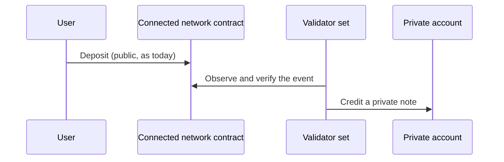
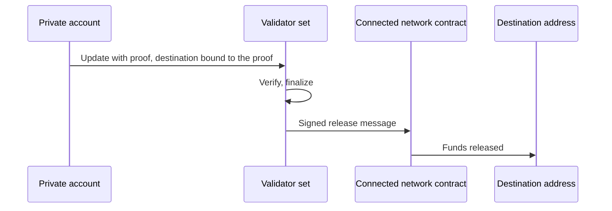

# 10 Connections

> Draft. Pre-launch, spec stage. Connections are designs. Nothing is deployed.

## In short

Hash Chain is its own network. Ethereum, Base and Robinhood Chain connect to it through bridge contracts that the Hash Chain validator set verifies, plus a liquidity network for fast transfers. Monero connects through native atomic swaps. Hash Chain is not itself a bridge. These connections are its doors.

## The doors

| Network | Asset | Mechanism | Order |
| --- | --- | --- | --- |
| Ethereum | ETH first, more assets to be specified | Bridge contract verified by validators, plus liquidity network | Early |
| Base | ETH first, more assets to be specified | Bridge contract verified by validators, plus liquidity network | Early |
| Robinhood Chain | ETH first, tokenized assets later | Bridge contract verified by validators, plus liquidity network | Later |
| Monero | XMR and ETH | Atomic swap, see [11](11-connection-monero.md) | Later |

## Coming in

## Going out

Only the first and last steps touch public networks. Between them the movement is private.

## Fast transfers: the liquidity network

Waiting for full verification can be slow. A liquidity network of independent providers fronts funds on the destination network immediately and is repaid after the verified message arrives. The recipient and amount are bound to the user's proof, so a provider can refuse or be slow but cannot redirect funds. The slower verified path is always the fallback. Providers earn a fee ([12](12-fees.md)).

## Robinhood Chain

ETH first. Tokenized assets are planned later, and arrive as private assets ([06](06-private-assets.md)). Which assets and in what order is to be specified.

## Technical details

- **Verification.** Validators sign messages about events on each connected network. How events are proven (light clients, attestations, or other) is to be specified per network.
- **Contract limits.** Per-period limits on bridge contracts reduce the impact of a bug or a dishonest validator majority ([09](09-security-and-trust.md)).
- **Binding.** The destination and fee of every exit are bound to the proof.
- **Assets.** Each external asset maps to an asset identifier on Hash Chain ([03](03-accounts-and-private-transfers.md)).

## Open questions

- Event proofs per connected network.
- Limits, delays and monitoring on bridge contracts.
- Liquidity network rules: collateral, selection, fee setting.
- Which assets beyond ETH and in what order.
- What happens to funds held in bridge contracts if Hash Chain halts for a long time.
