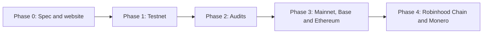

# 10 Roadmap

> Draft. Pre-launch, spec stage. The roadmap lists order, not dates. Phases may be re-ordered or changed as the design develops.

## In short

Hash Chain goes in five phases: write the spec, run a testnet, audit, launch mainnet with Base and Ethereum routes, then add Robinhood Chain and Monero. No dates are given because none are honest yet.

## Phases

| Phase | Scope | Exit criteria |
| --- | --- | --- |
| 0. Spec and website (now) | Protocol spec, brand, public site | Spec reviewed in public, major open questions answered |
| 1. Testnet | Shielded pool and Base bridge on a test network | Core flows work end to end, public feedback incorporated |
| 2. Audits | Independent review of contracts, circuits and bridge | Findings resolved, reports published |
| 3. Mainnet | Base route and Ethereum route (liquidity network) | Staged launch with limits, monitoring in place |
| 4. Expansion | Robinhood Chain route, Monero swaps, more assets | Each route reviewed before enabling |

## What each phase means for you

- **Phase 0.** Read, question and criticize. There is nothing to use yet.
- **Phase 1.** Test funds only. Expect resets and breaking changes.
- **Phase 2.** Nothing new to use. This phase exists to find problems before real value is at risk.
- **Phase 3.** Real value, with limits at first. Privacy is limited by the early anonymity set.
- **Phase 4.** More routes. Monero swaps need careful wallet support because of the online requirements in [05](05-route-monero.md).

## Technical details

- Routes are enabled one family at a time, each with its own review.
- Robinhood Chain starts with ETH only. Other assets follow.
- The Monero route depends on decisions listed in [05](05-route-monero.md), including cross-curve proofs and counterparty discovery.
- Phase order may change if the audit or setup decisions require it.

## Open questions

- Whether an incentivized testnet is useful and how to run it without weakening privacy.
- Whether Ethereum route can be enabled together with Base, or needs an extra review step.
- The decentralization path for the sequencer and prover roles after Phase 3.
