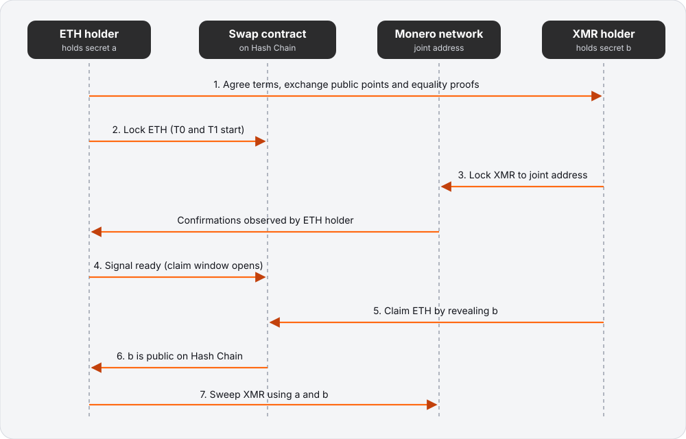
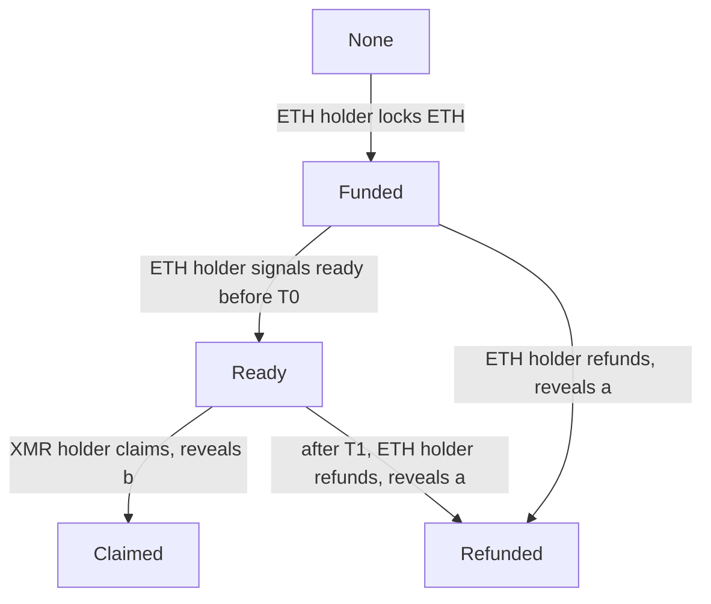
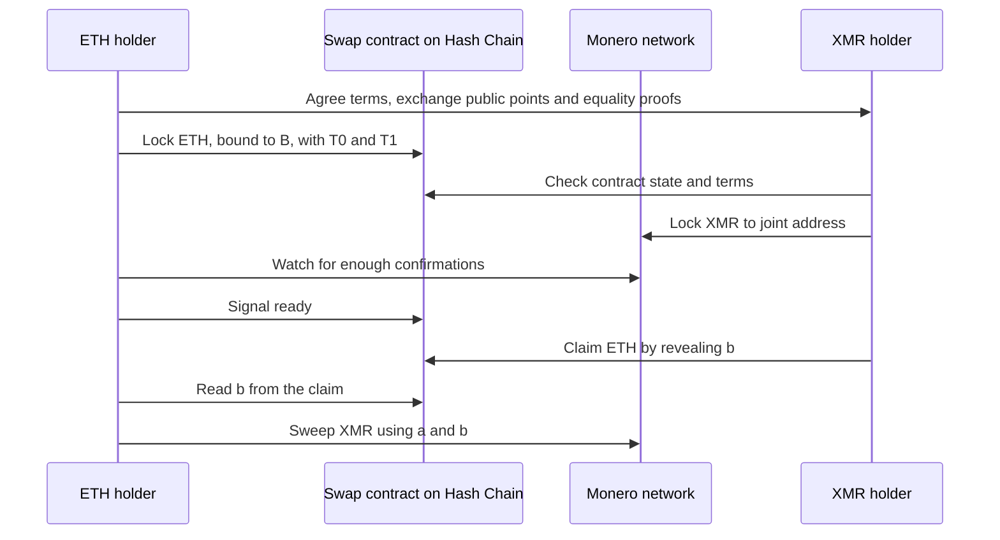

# 11 Monero connection

> Draft. Pre-launch, spec stage. Monero is one of the four connections described in [10](10-connections.md). The protocol below is a design sketch, not a final or audited specification. Cryptographic details marked "to be specified" are undecided.

## In short

Monero connects to Hash Chain through trustless atomic swaps between XMR and ETH. The ETH side lives on Hash Chain itself, locked in a native swap contract (see [05](05-private-swaps.md)) and the XMR side is locked to an address controlled by a key split between the two parties. By design, no party can end up with both sides, and no custodian ever holds the funds. The costs of failure are mostly delay and the need to stay online, described below.

## Why a swap and not a bridge

Monero has no smart contracts and no native timelocks, so nothing on Hash Chain can hold or release XMR. A bridge would need a custodian or a federation to hold XMR. An atomic swap avoids that: two people exchange assets directly, and cryptography makes the exchange all or nothing.

## Roles

- **ETH holder.** Holds ETH on Hash Chain and wants XMR. Holds secret scalar `a`, public point `A`.
- **XMR holder.** Holds XMR and wants ETH on Hash Chain. Holds secret scalar `b`, public point `B`.

A user may take either role. The counterparty is a swap participant found through a market mechanism that is to be specified (see [05](05-private-swaps.md)). The counterparty earns a swap fee ([12](12-fees.md)).

## Building blocks

- **Joint address.** The XMR is locked to an address whose spend key is `A + B`. Neither party can spend alone. Whoever learns both `a` and `b` can spend by themselves with an ordinary Monero transaction. The view key is shared so both can verify the lock.
- **Adaptor secret.** The ETH claim is bound to the point `B`. Claiming the ETH requires publishing the scalar `b`. That publication is what lets the ETH holder learn `b`, and it is called revealing the adaptor secret.
- **Equality proof.** Each party proves that the scalar behind its Monero-side point equals the scalar behind its Hash-Chain-side point. This is a cross-curve discrete logarithm equality proof. The exact construction is to be specified.
- **Timeouts.** Two deadlines, `T0` and `T1`, with `T0` earlier than `T1`, both measured in seconds from the moment the ETH lock is finalized on Hash Chain.
  - `T0`: the deadline by which the ETH holder must signal that the XMR lock is confirmed. Without that signal by `T0`, the swap is treated as cancelled and only a refund is possible.
  - `T1`: the deadline for the XMR holder to claim after the signal. After `T1`, the ETH holder may refund. A claim at or after `T1` is rejected, so the ETH holder has a clear moment after which the refund cannot be raced.

The lengths are set in the next section.

## Timelock and refund parameters

These values come from the reference calculator in [xmr-swap-model](https://github.com/HashChainL0/xmr-swap-model), which also contains a state machine and checks that a chosen `T0` and `T1` are consistent. Every number is a starting proposal for testing, not a measured or final value. This section addresses issue #5.

### Inputs

| Parameter | Proposed value | Reason |
| --- | --- | --- |
| Monero block time | 120 s target | Monero's target block interval |
| Block time variance factor | 2 | Monero blocks arrive at random, so n blocks often take longer than n times 120 s. Planning uses 240 s per block |
| Monero lock before spendable | 10 blocks | Monero outputs cannot be spent until 10 blocks old |
| Confirmations before "ready" | 10 | Never fewer than the lock above. Reorgs deeper than this are not expected on Monero. Larger swaps may require more |
| Counterparty lock allowance | 3600 s | Time for the XMR holder to see the ETH lock, check terms and broadcast the XMR lock |
| ETH holder online margin | 14400 s (4 h) | Slack for an ETH holder who is briefly offline before `T0` |
| XMR holder online margin | 21600 s (6 h) | Slack for an XMR holder who is briefly offline after ready |
| Claim inclusion | 20 blocks of 12 s | Allowance for the claim transaction to be included on Hash Chain. 12 s is a placeholder block time used for alignment only |
| Hash Chain finality | Deterministic, no extra wait | A lock counts once finalized, so no reorg allowance is added on the contract side |

### Resulting deadlines

| Quantity | Formula | Value |
| --- | --- | --- |
| Confirmation wait | 10 blocks x 120 s x 2 | 2400 s |
| `T0` | 3600 + 2400 + 14400 | 20400 s (5 h 40 min) |
| Claim window (`T1` minus `T0`) | 21600 + 20 x 12 | 21840 s (6 h 4 min) |
| `T1` | 20400 + 21840 | 42240 s (11 h 44 min) |

Consistency rules the calculator checks: `T1` is later than `T0`; `T0` covers the lock allowance and the confirmation wait; confirmations are at least the Monero unlock period; `T1` covers the expected unlock time; the claim window covers the XMR holder margin plus inclusion; both deadlines align to block boundaries.

Choosing longer margins makes failed swaps slower to resolve but makes it more likely a user who was briefly offline still completes. Shorter margins do the opposite. These are wallet-visible trade-offs, and wallets should show the worst-case time before the user commits.

### Who must be online, and when

| Phase | ETH holder | XMR holder |
| --- | --- | --- |
| Agree terms and exchange proofs | Online | Online |
| ETH locked, waiting for XMR lock | Not required. Refund is possible at any time | Online within the lock allowance (about 1 h) |
| XMR locked, confirmations accumulating | Must be online at some point before `T0` to signal ready, ideally right after 10 confirmations | Not required |
| Ready signalled, before `T1` | Not required | Must claim before `T1`, so must check in at least once in the claim window |
| After claim | Must come back once to sweep, no deadline on Monero | Nothing further |
| After refund | Nothing further | Must come back once to sweep XMR with `a` and `b`, no deadline on Monero |

Neither party is ever required to stay online continuously. The strictest requirement is one check-in per window. Wallets should persist swap state and secrets, and warn before the first lock.

### Griefing and its limits

Two griefing cases matter.

1. **ETH holder locks, XMR holder never locks.** The ETH holder refunds at any time. Cost: network fees and a short delay. The XMR holder lost nothing.
2. **Both locked, ETH holder goes silent.** The XMR holder cannot recover until the ETH holder acts, because recovery needs `a`, which only appears when the ETH holder refunds. Funds are not stolen, but they are frozen with no guaranteed end. The attacker also keeps their own ETH locked and gains nothing, so this is a nuisance attack, but it is a real cost to the victim.

Proposed mitigations, none yet decided:

- **Bond.** The ETH holder posts a small ETH bond with the lock. If the swap reaches the XMR lock and the ETH holder then neither signals ready by `T0` nor refunds within a grace period, the bond goes to the XMR holder. The bond is sized to at least the XMR holder's opportunity cost over the maximum freeze plus fees.
- **Forced refund reveal.** The ETH holder commits to `a` encrypted to the validator set at lock time, with a proof that the ciphertext is correct. If no ready signal arrives by `T0`, the validator set can release `a` to the XMR holder. Releasing `a` alone is harmless, since spending also needs `b`, which only the XMR holder knows. The trust cost is that a dishonest majority could release `a` early, which would help a colluding XMR holder and so adds one more reason a dishonest majority is out of the safe model (see [14](14-threat-model.md)).
- **Reputation and limits.** Per-counterparty size limits that grow with completed swaps, as a weaker complement.

The bond is the simpler option and does not add validator trust. The forced reveal removes the freeze entirely. Both can be combined. See [09](09-security-and-trust.md) for how this appears in the wider risk list.

## Corridors (proposed)

> Proposed, not decided. The proposal is written up as [HIP-5](https://github.com/HashChainL0/hips/blob/main/hips/hip-0005.md), which is a Draft.

The parameters above depend on the network that runs the ETH side: its block time, how many blocks a claim needs to be included, how quickly a watcher sees an event, and whether a data posting fee counts against a gas limit. The proposal reads the ETH and XMR swap as a set of corridors, one per connected network, in this proposed order: Robinhood Chain, Base, Ethereum.

- **Direct.** A corridor holds the whole swap on its own network. A swap never routes through a second network and has no bridging step, so one set of `T0` and `T1` applies and deadlines are never a sum over two networks.
- **Shared.** The state machine, the roles, the claim safety rule and the Monero side inputs are the same in every corridor.
- **Per corridor.** Block time, claim inclusion blocks, detection latency and the data posting component are chosen per corridor, from measurement.
- **No dates.** Opening a corridor depends on measured inputs and review. The order says nothing about when, and does not change the [roadmap](13-roadmap.md).

The reference model has the three corridors as plain data with illustrative numbers, see [CORRIDORS.md](https://github.com/HashChainL0/xmr-swap-model/blob/main/docs/CORRIDORS.md). This section sits next to the text above, which puts the ETH side on Hash Chain itself. How the two fit is an open question below.

## Contract states

Rules in words:

1. In `Funded`, the ETH holder may refund at any time. Refunding publishes `a`.
2. In `Funded`, the ETH holder may signal ready, only before `T0`.
3. In `Ready`, only the XMR holder may claim, until `T1`. Claiming publishes `b`.
4. In `Ready`, at or after `T1`, claims are rejected and the ETH holder may refund. A claim that was included before `T1` stands.
5. `Claimed` and `Refunded` are final.

## Happy path

## Direction 1: ETH to XMR (user is the ETH holder)

1. The user and the counterparty agree on the amounts, fee, `T0` and `T1`, exchange public points and equality proofs, and each verifies the other's proof.
2. The user locks ETH in the swap contract. The wallet stores `a` safely before this step.
3. The counterparty checks the contract and locks XMR to the joint address.
4. The wallet watches Monero. When the lock has the required confirmations, matches the agreed amount and goes to the correct joint address, it signals ready before `T0`.
5. The counterparty claims the ETH, which publishes `b`.
6. The wallet reads `b` and sweeps the XMR to the user's own Monero address using `a` and `b`.

If something stops: the user refunds. Refunding publishes `a` so the counterparty can recover any XMR they locked.

## Direction 2: XMR to ETH (user is the XMR holder)

1. The user and the counterparty agree on terms and exchange points and proofs.
2. The counterparty, who holds the ETH, locks it in the swap contract first. The user's wallet verifies the contract state, amounts, `B` and the deadlines.
3. The user locks XMR to the joint address. The wallet stores `b` safely before this step.
4. The counterparty confirms the XMR lock and signals ready before `T0`.
5. The user claims the ETH before `T1`, to a private account on Hash Chain, which publishes `b`.
6. The counterparty reads `b` and sweeps the XMR.

If something stops: if the counterparty refunds, `a` becomes public and the user sweeps the locked XMR back using `a` and `b`. The user must come back online to do so. There is no expiry on the Monero side.

## Failure matrix

| When | Who goes offline or misbehaves | Outcome |
| --- | --- | --- |
| Terms agreed, before any lock | Either | Nothing at stake. Swap does not start. |
| After ETH lock, XMR never locked | XMR holder disappears | ETH holder refunds and publishes `a`. No loss. |
| After both locks, before ready | ETH holder offline | ETH and XMR stay locked and nobody can steal either. When the ETH holder returns, they either signal ready before `T0` or refund. After `T0` only refund is possible, and the XMR holder recovers by sweeping with `a` and `b`. Until the ETH holder acts, the XMR holder has no way to recover and no guaranteed recovery time. A deliberately absent ETH holder can therefore freeze the XMR holder's funds (a griefing risk, see the griefing section above). |
| After ready, before claim | XMR holder offline | After `T1` the ETH holder refunds. XMR holder later sweeps their XMR back using `a` and `b`. Swap fails, no loss. |
| After ready, XMR holder claims | ETH holder offline | Claim publishes `b`. ETH holder sweeps whenever they return, using stored `a`. No deadline on Monero. |
| After claim | XMR holder offline | Nothing further is needed from them. |
| ETH holder signals ready on a bad or missing XMR lock | ETH holder error, or XMR holder lies | XMR holder can claim ETH and the ETH holder finds no XMR. This is the main user-side risk. The wallet must verify the lock automatically. |
| A user loses their secret (`a` or `b`) | Either | The funds that depend on it can become unrecoverable. Wallets must back up the secret before the first lock. |
| Validator set halts or censors | Infrastructure | Deadlines are measured on Hash Chain time. A long halt of the validator set may cause a refund, not a theft. See [09](09-security-and-trust.md). |
| Monero chain reorganization | Infrastructure | Wait for enough confirmations before signalling ready. |
| Both parties offline | Both | Funds remain in their locked state until someone returns. |

## Privacy properties

- On Monero, the swap looks like an ordinary transfer to a one-time address. The joint address is not linkable to either party by itself.
- On Hash Chain, the ETH lock and the claim are visible to the validators that run the swap contract, so the design tries to keep them unlinkable to your account. For privacy, the lock should be funded from a private account and the claim should pay into a private account. The exact mechanism for funding the lock without linking is to be specified.
- Amounts and timing of the swap leak to the counterparty. Choose counterparties and amounts with that in mind.

## Technical details

- **Curves.** Monero uses Ed25519. The EVM can verify secp256k1 points cheaply through existing primitives. The design binds one scalar to a point on each curve with a DLEQ-style proof.
- **Claim check.** The swap contract on Hash Chain accepts a claim only if the published scalar matches the committed point `B` on the Hash Chain side.
- **Refund check.** Likewise for `a` and `A`.
- **Monero spend.** Once a party knows both `a` and `b`, the joint key is a normal single key. The sweep is a standard Monero transaction.
- **Confirmation count.** Ten by default, agreed between the parties as part of the terms and never below the Monero unlock period. See the parameter table.
- **Persistence.** Wallets must persist swap state and secrets so that a crashed client can resume or refund.

## Open questions

- The exact cross-curve proof and the assurance level needed.
- Counterparty discovery: an order book, quote requests, or a set of swap providers, and how fees are set.
- How to fund the ETH lock from private accounts and claim into private accounts without leaking a link.
- Measured values: the table above is a proposal. Real Monero block time behavior, Hash Chain block time and wallet reaction time need testing before the numbers are fixed.
- How wallets warn users about the need to be online.
- Whether the signal-ready step can be replaced by something that needs less online presence from the ETH holder.
- Griefing: choosing between the bond, the forced refund reveal, or both, and sizing the bond.
- Whether the Monero lock confirmation count should scale with swap size.
- Watchtowers: whether an optional service can submit refunds or sweeps on behalf of an offline user without learning secrets.
- Corridors: whether the swap contract runs on each connected network or only on Hash Chain, and how a corridor's measured inputs enter the parameter table. See HIP-5.
