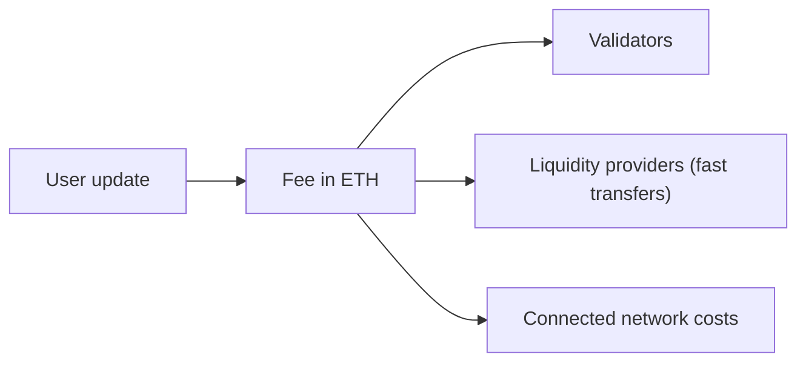

# 12 Fees

> Draft. Pre-launch, spec stage. No fee values are set. This document describes what fees exist, not how large they are.

## In short

Fees on Hash Chain are paid in ETH. No token is required to use the network. Fees pay for the work the network does: executing updates, verifying proofs, keeping data available and operating connections.

## Fee components

| Component | Pays for | Goes to |
| --- | --- | --- |
| Execution | Applying an update to state | Validators |
| Proof verification | Checking the zero-knowledge proof | Validators |
| Data availability | Keeping encrypted payloads available for recipients | Validators or storage nodes, to be specified |
| Connection | Verifying events and releasing funds on connected networks, including their own network costs | Validators, and the connected network |
| Fast transfer | Fronting funds on a destination network | Liquidity provider |
| Swap | Matching and counterparty service for swaps ([05](05-private-swaps.md), [11](11-connection-monero.md)) | Matching participants, to be specified |

## How a user sees fees

One total, shown in ETH before signing. The wallet breaks it down on request. The fee is bound to the user's proof so nobody can raise it afterwards.

## Fee market

How fees are priced, whether they vary with load, and how users pay without linking their account to a public fee payer are to be specified.

## No token

Validators are paid from fees, in ETH. No new token is needed to use, secure or build on Hash Chain.

## Technical details

- **Fee binding.** The fee field is part of the proof's public inputs ([03](03-accounts-and-private-transfers.md)).
- **Fee privacy.** Fees should not reveal amounts or parties. Paying from a private account is the default design.
- **Rewards.** Validator rewards come from collected fees ([02](02-validators-and-staking.md)).

## Open questions

- Pricing model for each component.
- Private fee payment without a public payer.
- Subsidies or sponsored fees for apps and merchants.
- How data availability costs are measured and charged.
