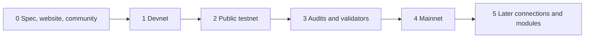

# 13 Roadmap

> Draft. Pre-launch, spec stage. Phases are ordered, not dated. Scope can move between phases.

## In short

Hash Chain is at phase 0. The work moves from spec, to a devnet, to a public testnet, to audits, to mainnet, and then to the later connections and modules. No dates are given because dates would be guesses.

## Phases

| Phase | Contents |
| --- | --- |
| 0. Spec, website, community | This specification, the website and open discussion. Now. |
| 1. Devnet | Private accounts and payments, validator client. |
| 2. Public testnet | Private swaps, Base and Ethereum connections, SDK preview. |
| 3. Audits and validator onboarding | Independent audits. Onboarding of the first validator set. |
| 4. Mainnet | Accounts, payments, swaps, Base and Ethereum connections. |
| 5. Later | Robinhood Chain, Monero swaps, private assets and apps. |

## Reading the roadmap honestly

Phases do not start until the previous one is in good shape. Audits come before mainnet. Early mainnet will have limits, and the anonymity set will be small at first ([09](09-security-and-trust.md)).

## Technical details

Each phase maps to documents in this spec: accounts and payments ([03](03-accounts-and-private-transfers.md), [04](04-private-payments.md)), swaps ([05](05-private-swaps.md)), connections ([10](10-connections.md), [11](11-connection-monero.md)), assets and apps ([06](06-private-assets.md), [07](07-private-apps.md)).

## Open questions

- Exact scope of the devnet and what makes a phase complete.
- Validator onboarding process and early set composition.
- Whether any module moves earlier or later based on audit findings.
